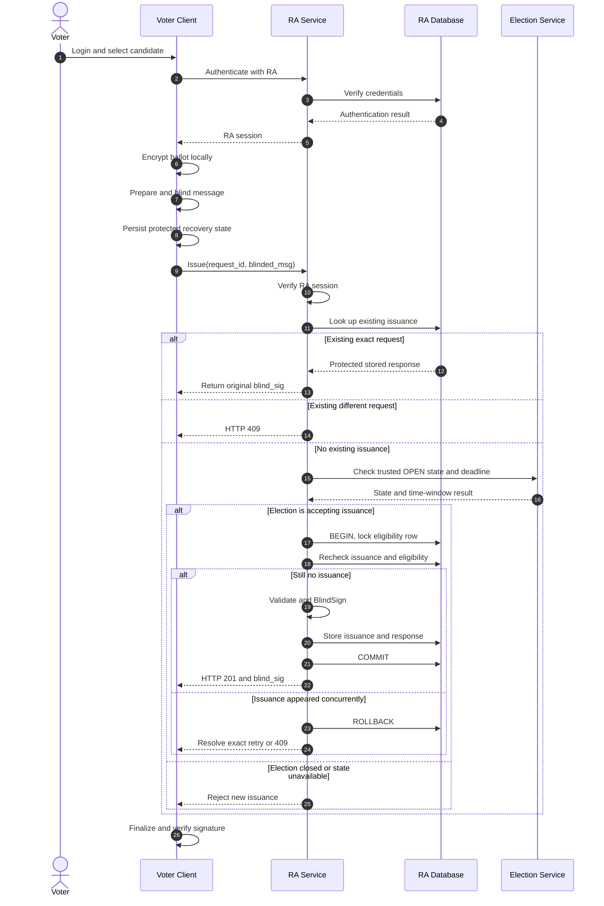

# Secure E-Voting System
## 07 - Authentication and Blind Credential Issuance

Version: 1.0
Status: Draft
Phase: P01.2.2

---

## 1. Objective

Design voter authentication, eligibility
verification, RSA blind credential issuance
and safe recovery from lost responses.

Primary Use Cases:
- UC-05: Authenticate Voter
- UC-06: Select and Encrypt Ballot
- UC-07: Request Blind Credential

Security Requirements:
- SR-01: Conditional anonymity
- SR-02: Credential authenticity
- SR-03: Single issuance
- SR-05: Secure communication
- SR-06: Secure storage

---

## 2. Components

### Voter Client
Responsibilities:
- Authenticate with RA
- Verify the independently trusted signed frozen configuration and RA/Tally public-key fingerprints before selecting and encrypting the ballot
- Select and encrypt the ballot locally
- Generate a cryptographically random serial
- Prepare and blind the credential message
- Retain temporary cryptographic state
- Finalize and verify the blind signature

### Registration Authority
Responsibilities:
- Authenticate voter identity
- Verify election eligibility
- Check authoritative election state
- Enforce one issuance per voter/election
- Blind-sign eligible requests
- Return the original response on valid retry

### Election Metadata Service
Responsibilities:
- Provide authoritative election status
- Provide public-key metadata
- Authenticate internal service requests

### RA Database
Responsibilities:
- Store voter accounts
- Store election eligibility
- Store credential issuance status
- Store bounded recovery metadata
- Prevent concurrent duplicate issuance

---

## 3. Cryptographic Configuration

Credential Algorithm:
RSABSSA-SHA384-PSS-Randomized

Reference:
RFC 9474

Parameters:
- RSA-PSS hash: SHA-384
- MGF: MGF1-SHA384
- PSS salt length: 48 bytes
- Prepare random prefix: 32 bytes

RA signing and Tally encryption MUST use
different key pairs.

For this project, use a separately generated
RSA-3072 RA key pair as a proposed MVP
configuration, subject to library support
and RFC test-vector verification.

---

## 4. Credential Message Construction

### 4.1. Authoritative Message Format

The authoritative application-message
format is defined in:

Document 08, Section 7.

Client, RA-related cryptographic components,
Voting and Tally must use the same
cryptographic profile.

### 4.2. Client Ballot Preparation

Client generates:

- election_id
- 32-byte cryptographically random serial
- encrypted ballot envelope

The serial is encoded using Base64url
without padding.

The envelope follows Document 08,
Section 6.

### 4.3. Envelope Hash

The Client canonicalizes the complete
encrypted envelope using RFC 8785 JCS.

envelope_bytes = JCS(envelope)

envelope_hash = SHA256(envelope_bytes)

The envelope hash is represented as
a lowercase 64-character hexadecimal string.

### 4.4. Application Message

The exact application message object is:

{
  "domain": "secure-evoting-ballot-v1",
  "schema_version": 1,
  "election_id": "<ELECTION_UUID>",
  "serial": "<BASE64URL_SERIAL>",
  "envelope_hash": "<SHA256_HEX>"
}

M = JCS(application_message_object)

M is the canonical UTF-8 byte string.

The application message must use
the exact same field names, field types
and encodings as Document 08.

Duplicate JSON property names are rejected.

### 4.5. Prepare and Blind

For RSABSSA-SHA384-PSS-Randomized:

prepared_msg = PrepareRandomize(M)

prepared_msg = random_32_bytes || M

Client then performs:

blinded_msg, inv = Blind(
    PK_RA,
    prepared_msg
)

PK_RA is the trusted election-specific
RA public key.

The Client securely preserves the
original blinded request and unblinding
state before requesting issuance.

### 4.6. RA Blind Signing

RA receives:

- authenticated RA session
- election_id
- request_id
- blinded_msg

RA must not receive:

- plaintext vote
- candidate_id
- ballot serial
- encrypted ballot envelope
- prepared_msg
- unblinding factor

RA selects the election-specific
signing key based on trusted election
metadata and verified eligibility.

After authorization, RA performs
BlindSign using the RFC 9474 profile.

### 4.7. Finalize and Verify

After receiving blind_sig:

signature = Finalize(
    PK_RA,
    prepared_msg,
    blind_sig,
    inv
)

Client verifies the finalized signature
against the entire prepared_msg.

Voting later verifies the same signature.

For the Randomized variant, Voting
removes the first 32 bytes from
prepared_msg to recover M.

Voting compares M with the exact
canonical application message rebuilt
from the submitted ballot.

Any mismatch must reject the ballot.

### 4.8. Required Consistency

The following must match Document 08:

- Domain separator
- JSON field names and types
- JCS serialization
- SHA-256 envelope hash
- Lowercase digest encoding
- Base64url serial encoding
- Election-specific RA public key
- RSABSSA parameters
- Randomized preparation format

A signature for another election
must not authorize this election.

---

## 5. Authentication Workflow

1. Voter enters username and password.
2. Client establishes HTTPS connection to RA.
3. Client sends authentication request.
4. RA verifies credentials.
5. RA checks account status.
6. RA creates a short-lived session.
7. RA returns authentication success.
8. Voter selects an election.
9. RA checks election eligibility.
10. Client displays eligibility result.

Authentication does not issue a credential.

RA session is only valid for RA endpoints.

Voting MUST NOT receive RA authentication
tokens, cookies or Voter ID.

---

## 6. Blind Credential Sequence

### Sequence Rules

- An exact retry is checked before requiring
  the election to still be OPEN.
- A new issuance requires trusted OPEN state
  and a valid server-side time window.
- All issuance writes are protected by a
  per-voter/election database lock.
- Concurrent requests must recheck issuance
  inside the transaction.
- A blind signature is returned only after
  the issuance transaction commits.
- RA never receives the unblinded ballot
  message or encrypted ballot envelope.
- No new credential is authorized after
  the election has closed.
- An issuance authorized before closure
  may still complete afterward because
  the two services do not share a transaction.

---

## 7. Idempotent Issuance Design

### 7.1. Objective

Issue at most one blind credential per
voter and election, while supporting
recovery of the original issuance response.

### 7.2. Per-Election RA Key

For the MVP, each election has a dedicated
RA blind-signing key pair.

RA selects its signing key using the
authenticated and authorized election_id,
not a client-supplied arbitrary key ID.

Voting verifies the signature using the
trusted RA public key assigned to that election.

The application message also contains
the election_id and domain separator.

RA signing keys must not be reused for
Tally encryption or snapshot signing.

### 7.3. Client Request Identity

Before contacting RA, Client creates:

- election_id
- random request_id
- blinded_msg
- corresponding unblinding state

Client persists the original request and
recovery state in protected local storage.

Retries must reuse exactly the same:

- election_id
- request_id
- blinded_msg

The Client must not regenerate a different
blinded message when retrying issuance.

### 7.4. RA Database Record

Proposed fields:

- voter_id
- election_id
- request_id
- blinded_request_hash
- encrypted_blind_signature
- ra_key_id
- issuance_status
- issued_at

Database constraint:

UNIQUE(voter_id, election_id)

Recovery data must be access-controlled.

The stored blind signature response must
be encrypted at rest using a separately
protected application storage key.

RA must not retain:

- ballot serial
- plaintext vote choice
- encrypted envelope
- unblinded application message
- client unblinding factor

### 7.5. First Issuance

1. Authenticate the voter.
2. Validate the blinded request format.
3. Check for an existing issuance.
4. If none exists, check the trusted
   election state and server-side deadline.
5. Begin a RA database transaction.
6. Lock the voter/election eligibility row.
7. Recheck eligibility and issuance.
8. Reject if an issuance already exists.
9. Select the election-specific RA key.
10. Perform BlindSign.
11. Encrypt the blind signature for storage.
12. Insert the issuance record.
13. Commit the transaction.
14. Return HTTP 201 and blind_sig.

If the transaction fails, no successful
credential response is returned.

### 7.6. Exact Retry

1. Authenticate the same voter.
2. Locate the prior issuance record.
3. Compare election_id and request_id.
4. Compare the blinded request hash.
5. Verify the stored RA key identifier.
6. Retrieve the protected response.
7. Return the exact previously issued
   blind signature.
8. Do not perform BlindSign again.

Expected response:

HTTP 200

status = replayed

The retry must not create another
issuance record or independent signature.

### 7.7. Different Second Request

If the voter has already received issuance
but sends a different request_id or
different blinded_msg:

- Reject with HTTP 409.
- Do not generate a new signature.
- Do not modify the original credential.
- Record a privacy-safe audit event.

### 7.8. Retry After Election CLOSED

An exact retry of a previously committed
issuance may return the original response
within the configured recovery period.

This is not a new credential issuance.

Any new issuance after CLOSED is rejected.

Voting independently enforces its CLOSED
state and server-side ballot deadline.

Therefore, retrieving an old credential
does not permit voting after closure.

### 7.9. Concurrent Issuance

Concurrent requests for the same voter
and election must serialize using the
locked eligibility record.

The database unique constraint provides
an additional protection layer.

Expected behavior:

- One issuance record is committed.
- An exact concurrent retry may receive
  the stored original response.
- A different concurrent request receives
  an already-issued error.
- No second independent credential is signed
  after the first successful issuance.

### 7.10. Failure and Recovery

Lost response after commit:

- Client resends the original request.
- RA returns the original blind signature.

RA unavailable:

- Client retains protected recovery state.
- Retry is possible when service returns.

Client loses blinding state:

- MVP cannot guarantee recovery.
- No automatic second issuance is allowed.

Storage encryption key unavailable:

- Previously stored responses cannot
  be recovered until key access is restored.
- RA must not issue a replacement signature.

### 7.11. Remaining Limitations

- Client recovery state needs encrypted storage.
- Recovery retention must be finalized.
- RA and election closing are not globally atomic.
- Cross-service metadata correlation is not
  completely prevented.
- Production-grade key storage is outside
  the local MVP scope.

---

## 8. Client Temporary State

Client should securely retain:

- election_id
- random serial
- encrypted envelope
- prepared_msg
- blinded_msg
- unblinding state
- request_id
- key identifiers
- finalized signature when available

For the MVP:

- Use protected temporary local storage.
- Avoid plaintext private cryptographic
  recovery state in persistent files.
- Do not store RA login credentials with
  ballot recovery data.
- Delete temporary sensitive state
  according to the recovery policy.
- Keep receipt information after submission.

Exact encrypted local storage format
is deferred to implementation design.

---

## 9. API Contract Draft

### POST /api/v1/ra/auth/login

Request:
{
  "username": "voter001",
  "password": "example-password"
}

Response:
{
  "status": "authenticated",
  "access_token": "<RA_SESSION_TOKEN>",
  "token_type": "bearer"
}

Token format and expiry remain to be decided.

### POST /api/v1/ra/credentials/issue

Headers:
Authorization: Bearer <RA_SESSION_TOKEN>

Request:
{
  "election_id": "<ELECTION_UUID>",
  "request_id": "<REQUEST_UUID>",
  "blinded_msg": "<BASE64URL_BLINDED_MESSAGE>"
}

Response - First Issuance:
HTTP 201

{
  "status": "issued",
  "ra_key_id": "<ELECTION_RA_KEY_ID>",
  "blind_sig": "<BASE64URL_BLIND_SIGNATURE>"
}

Response - Exact Retry:
HTTP 200

{
  "status": "replayed",
  "ra_key_id": "<ELECTION_RA_KEY_ID>",
  "blind_sig": "<SAME_BASE64URL_BLIND_SIGNATURE>"
}

Response - Already Issued:
HTTP 409

{
  "error_code": "CREDENTIAL_ALREADY_ISSUED",
  "message": "Credential issuance is not available."
}

All placeholders are illustrative.

### Binary Field Encoding Contract

All cryptographic binary fields transported
through JSON APIs must use:

Base64url without padding (RFC 4648).

Applicable fields:

- blinded_msg
- blind_sig
- prepared_msg
- finalized signature
- ballot serial
- encrypted key
- AES-GCM nonce
- encrypted ciphertext

Encoding rules:

1. Use the URL-safe Base64 alphabet.
2. Do not include trailing "=" padding.
3. Do not use "+" or "/" characters.
4. Reject whitespace in encoded values.
5. Reject invalid Base64url characters.
6. Decode before cryptographic operations.
7. Validate decoded byte lengths.
8. Reject non-canonical encodings.

The decoded blinded message and blind
signature must have the byte lengths
required by the selected RSA modulus.

For an RSA-3072 key, this is 384 bytes.

SHA-256 digests represented as text
must use lowercase hexadecimal encoding.

JSON request_id and election_id fields
remain UUID strings, not Base64url values.

RA access tokens are opaque authentication
credentials and are governed by their
separate authentication-token format.

Client, RA, Voting and Tally must use
the same encoding and decoding rules.

---

## 10. Security Invariants

ISS-01:
One issuance per voter/election.

ISS-02:
RA does not receive plaintext vote choices.

ISS-03:
RA does not store ballot serials.

ISS-04:
Blind signature must conform to RFC 9474.

ISS-05:
Same request retry returns the original
response without a second issuance.

ISS-06:
Different requests after issuance
must be rejected.

ISS-07:
Client must verify the finalized signature.

ISS-08:
RA session must not be sent to Voting.

ISS-09:
Issuance records and recovery responses
must be access-controlled.

ISS-10:
Private keys and authentication secrets
must never appear in application logs.

---

## 11. Planned Tests

| ID | Scenario | Expected |
|---|---|---|
| ISS-T01 | Valid login | Authenticated |
| ISS-T02 | Invalid password | Rejected |
| ISS-T03 | Ineligible voter | Rejected |
| ISS-T04 | First valid issuance | HTTP 201 |
| ISS-T05 | Exact retry | Same blind_sig |
| ISS-T06 | Different second request | HTTP 409 |
| ISS-T07 | 20 concurrent issuance requests | One issuance |
| ISS-T08 | Invalid blinded message | Rejected |
| ISS-T09 | Forged blind signature response | Finalize fails |
| ISS-T10 | Election not OPEN | New issuance rejected |
| ISS-T11 | RA key inaccessible | No issuance |
| ISS-T12 | Inspect RA DB/logs | No ballot choice or serial |

---

## 12. Remaining Design Decisions

DR-01:
Exact retry after successful issuance
is the proposed recovery mechanism.

Pending:
- Retention duration
- Retry after election closure
- Encrypted client recovery storage
- Behavior after lost local blinding state

DR-02:
RA checks the trusted Election Service.

Pending:
- Exact synchronization with closing
- In-flight issuance policy
- Failure/retry consistency

DR-05:
RA and Voting authentication are separate.

Pending:
- Cookie isolation and privacy metadata
- Log correlation controls
- Network-level anonymity limitations

---

## 13. Acceptance Criteria

- Authentication workflow is documented.
- Blind issuance sequence is documented.
- RFC 9474 variant is fixed.
- Database uniqueness rule is defined.
- Exact retry behavior is specified.
- Double issuance is rejected.
- Identity and ballot-data separation
  is explicitly documented.
- Remaining risks are tracked.

Status:
DESIGN DRAFT - IMPLEMENTATION NOT STARTED
