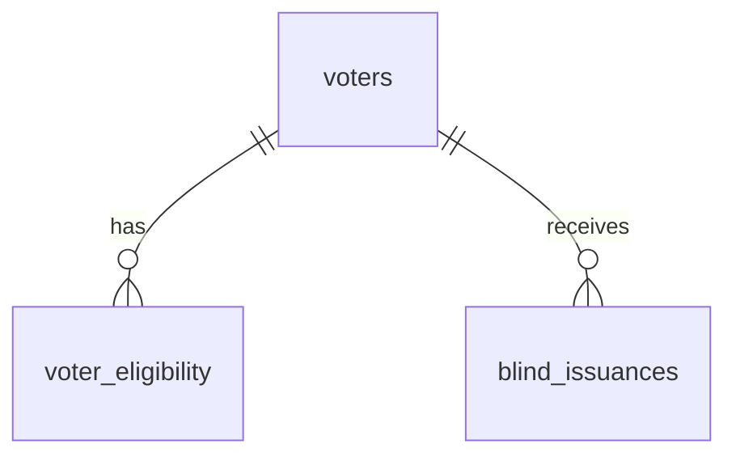
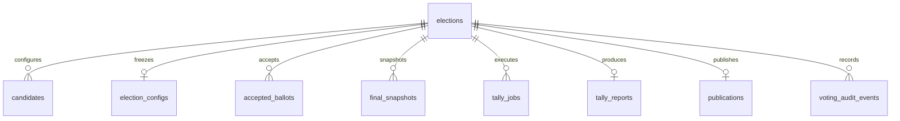

# P01.3 — PostgreSQL Database Design

**Status:** Draft
**Phase:** P01.3
**Dependencies:** Documents 06–11

---

## 1. Purpose

Define the PostgreSQL database architecture
for the Secure E-Voting MVP.

This document covers:

- Registration Authority Database
- Voting Database
- Entity relationships
- Primary and foreign keys
- Uniqueness and integrity constraints
- Concurrency controls
- Access-control requirements
- Migration and testing requirements

## 2. Database Separation

The system uses two logically independent
PostgreSQL databases:

1. ra_db
2. voting_db

The RA database stores voter identity,
eligibility and blind credential issuance.

The Voting database stores election state,
encrypted ballots, snapshots, tally jobs
and publication artifacts.

No cross-database foreign key or direct
join may link voter identity to ballots.

Voting database tables must not contain:

- voter_id
- voter email or username
- RA authentication token
- RA request_id
- plaintext vote choices
- identity-correlating network metadata

RA database tables must not contain:

- ballot serial
- encrypted ballot envelope
- envelope_hash
- plaintext vote choices
- ballot receipt_hash

## 3. Registration Authority Database

Database name: ra_db

### 3.1. Entity Inventory

| Table | Purpose |
|---|---|
| voters | Store registered voter accounts |
| voter_eligibility | Store election-specific voter eligibility |
| blind_issuances | Track single-use blind credential issuance and exact retry |
| ra_audit_events | Record privacy-safe RA operations |
| ra_signing_keys | Store election-specific RA public-key and signing-key metadata |

### 3.2. Conceptual ERD



### 3.3. Important Rules

- One eligibility record per voter/election.
- At most one issuance per voter/election.
- Exact retry may return a protected
  previously issued blind signature.
- Credential issuance requires an
  authoritative election-state check.
- RA must never receive plaintext votes.
- Election IDs are logical references
  to Voting DB, not cross-database FKs.

## 4. Voting Database

Database name: voting_db

### 4.1. Entity Inventory

| Table | Purpose |
|---|---|
| elections | Authoritative election lifecycle |
| candidates | Configurable candidate catalog during DRAFT |
| election_configs | Immutable signed frozen configuration |
| accepted_ballots | Encrypted accepted ballot records |
| final_snapshots | Finalized ballot snapshot metadata and evidence references |
| tally_jobs | Tally execution, lease and fencing token |
| tally_reports | Authoritative aggregate tally result |
| publications | Signed publication manifest references |
| voting_audit_events | Privacy-safe election and security audit events |

### 4.2. Conceptual ERD



### 4.3. Important Rules

- The elections table owns election status.
- Candidate records become immutable
  after the election opens.
- One authoritative frozen configuration
  exists for each opened election.
- Each ballot has a unique
  (election_id, serial) combination.
- Accepted ballots cannot be silently
  updated or deleted.
- Only one authoritative FINALIZED
  snapshot is permitted per election.
- Tally jobs use leases and fencing tokens.
- Only one successful authoritative
  tally report is allowed per election.
- Publication must reference the verified
  tally report and frozen configuration.

## 5. Cross-Service Communication

RA queries authoritative election status
using an authenticated internal API.

RA must not rely solely on a cached
election status when authorizing issuance.

A close-election transaction in voting_db
does not atomically commit with ra_db.

An issuance authorized before closing
may finish afterward.

Voting independently rejects ballots
after the authoritative close/deadline.

## 6. Design Status

The ERDs above represent conceptual
relationships, not finalized SQL schemas.

Column definitions, PostgreSQL constraints,
indexes, transaction isolation and access
roles will be defined in subsequent steps.

No database implementation is considered
complete until migrations and integration
tests have passed.

---

## 7. RA Database — Initial PostgreSQL Schema

This section defines the first RA database
tables for the Secure E-Voting MVP.

Database: ra_db

These definitions are design drafts.
They must be implemented and tested
through PostgreSQL migrations.

### 7.1. Voters Table

Purpose:

Store voter account identity and
authentication subject references.

PostgreSQL DDL draft:

```sql
CREATE TABLE voters (
    voter_id UUID PRIMARY KEY,

    auth_provider VARCHAR(128) NOT NULL,
    auth_subject VARCHAR(255) NOT NULL,

    is_active BOOLEAN NOT NULL DEFAULT TRUE,

    created_at TIMESTAMPTZ NOT NULL
        DEFAULT clock_timestamp(),

    updated_at TIMESTAMPTZ NOT NULL
        DEFAULT clock_timestamp(),

    CONSTRAINT uq_voters_auth_subject
        UNIQUE (auth_provider, auth_subject),

    CONSTRAINT ck_voters_auth_provider
        CHECK (btrim(auth_provider) <> ''),

    CONSTRAINT ck_voters_auth_subject
        CHECK (btrim(auth_subject) <> '')
);
```

#### Field Definitions

| Field | Type | Description |
|---|---|---|
| voter_id | UUID | Internal voter identifier |
| auth_provider | VARCHAR(128) | Authentication provider identifier |
| auth_subject | VARCHAR(255) | Provider-specific stable user identifier |
| is_active | BOOLEAN | Whether the voter account is active |
| created_at | TIMESTAMPTZ | Record creation time |
| updated_at | TIMESTAMPTZ | Last modification time |

#### Integrity Rules

1. voter_id is generated securely by
   the trusted application.

2. (auth_provider, auth_subject)
   uniquely identifies an account.

3. A disabled voter account cannot
   receive a new blind credential.

4. Existing voter records must not be
   physically deleted while referenced
   by eligibility or issuance records.

5. updated_at must be maintained by
   the application or a database trigger.

6. Authentication secrets must not
   be stored in plaintext.

7. This table must not contain ballot
   serials, encrypted ballot envelopes
   or plaintext vote choices.

#### Privacy Rules

Authentication information is restricted
to the RA security boundary.

Voting services must not have direct
read access to this table.

The MVP should minimize unnecessary
personally identifiable information.

### 7.2. Voter Eligibility Table

Purpose:

Track whether a voter is eligible
for a specific election.

Each voter/election pair may have
only one eligibility record.

PostgreSQL DDL draft:

```sql
CREATE TABLE voter_eligibility (
    eligibility_id UUID PRIMARY KEY,

    voter_id UUID NOT NULL,

    election_id UUID NOT NULL,

    is_eligible BOOLEAN NOT NULL
        DEFAULT FALSE,

    created_at TIMESTAMPTZ NOT NULL
        DEFAULT clock_timestamp(),

    updated_at TIMESTAMPTZ NOT NULL
        DEFAULT clock_timestamp(),

    CONSTRAINT fk_eligibility_voter
        FOREIGN KEY (voter_id)
        REFERENCES voters(voter_id)
        ON DELETE RESTRICT,

    CONSTRAINT uq_voter_election_eligibility
        UNIQUE (voter_id, election_id)
);
```

#### Field Definitions

| Field | Type | Description |
|---|---|---|
| eligibility_id | UUID | Eligibility record identifier |
| voter_id | UUID | Foreign key to voters |
| election_id | UUID | Logical election identifier |
| is_eligible | BOOLEAN | Whether credential issuance is permitted |
| created_at | TIMESTAMPTZ | Record creation time |
| updated_at | TIMESTAMPTZ | Last modification time |

#### Integrity Rules

1. Eligibility IDs are generated securely
   by the trusted application.

2. The voter_id references an existing
   record in the voters table.

3. A voter/election pair must be unique.

4. election_id refers logically to
   the election in voting_db.

5. No cross-database foreign key
   is created for election_id.

6. Missing eligibility records
   must be treated as not eligible.

7. Eligibility must be TRUE before
   a new blind credential is issued.

8. The voter account must also be active.

9. The authoritative election state
   must permit new issuance.

10. Changes to eligibility must produce
    an appropriate RA audit event.

#### Issuance and Revocation

Revoking eligibility prevents future
credential issuance.

Revocation does not automatically
invalidate a blind credential that
has already been issued.

A separate credential revocation scheme
is outside the current MVP scope.

#### Concurrency Requirement

Blind credential issuance must use
transactional coordination to prevent
two concurrent requests from issuing
different credentials to the same voter
for the same election.

The later blind_issuances table will
enforce:

UNIQUE (voter_id, election_id)

The issuer must recheck eligibility
and existing issuance state inside
its authoritative transaction.

The exact transaction and retry rules
will be defined with the
blind_issuances schema.

### 7.3. Blind Issuances Table

Purpose:

Track the single committed blind credential
issuance for each voter/election pair.

Support exact request replay without
performing BlindSign again.

Preserve issuance uniqueness even after
encrypted recovery data is purged.

#### PostgreSQL DDL Draft

```sql
CREATE TABLE blind_issuances (
    issuance_id UUID PRIMARY KEY,

    voter_id UUID NOT NULL,
    election_id UUID NOT NULL,
    request_id UUID NOT NULL,

    blinded_request_hash BYTEA NOT NULL,

    ra_key_id VARCHAR(128) NOT NULL,

    encrypted_blind_signature BYTEA,
    storage_nonce BYTEA,
    storage_key_id VARCHAR(128),

    issuance_status VARCHAR(16) NOT NULL
        DEFAULT 'ISSUED',

    recovery_state VARCHAR(16) NOT NULL
        DEFAULT 'RETAINED',

    issued_at TIMESTAMPTZ NOT NULL
        DEFAULT clock_timestamp(),

    recovery_expires_at TIMESTAMPTZ NOT NULL,

    CONSTRAINT fk_blind_issuance_eligibility
        FOREIGN KEY (voter_id, election_id)
        REFERENCES voter_eligibility (
            voter_id, election_id
        )
        ON UPDATE RESTRICT
        ON DELETE RESTRICT,

    CONSTRAINT uq_blind_issuance_voter_election
        UNIQUE (voter_id, election_id),

    CONSTRAINT ck_blinded_request_hash_length
        CHECK (
            octet_length(blinded_request_hash) = 32
        ),

    CONSTRAINT ck_issuance_status
        CHECK (issuance_status = 'ISSUED'),

    CONSTRAINT ck_ra_key_id
        CHECK (btrim(ra_key_id) <> ''),

    CONSTRAINT ck_recovery_expiry
        CHECK (recovery_expires_at > issued_at),

    CONSTRAINT ck_recovery_data
        CHECK (
            (
                recovery_state = 'RETAINED'
                AND encrypted_blind_signature
                    IS NOT NULL
                AND octet_length(
                    encrypted_blind_signature
                ) > 16
                AND storage_nonce IS NOT NULL
                AND octet_length(storage_nonce) = 12
                AND storage_key_id IS NOT NULL
                AND btrim(storage_key_id) <> ''
            )
            OR
            (
                recovery_state = 'PURGED'
                AND encrypted_blind_signature IS NULL
                AND storage_nonce IS NULL
                AND storage_key_id IS NULL
            )
        )
);
```

#### Field Definitions

| Field | Type | Purpose |
|---|---|---|
| issuance_id | UUID | Internal issuance record ID |
| voter_id | UUID | Reference to voter |
| election_id | UUID | Election identifier |
| request_id | UUID | Client-generated idempotency key |
| blinded_request_hash | BYTEA | SHA-256 of decoded blinded message |
| ra_key_id | VARCHAR(128) | Election-specific RA signing key |
| encrypted_blind_signature | BYTEA | AES-GCM protected recovery signature |
| storage_nonce | BYTEA | AES-GCM recovery nonce |
| storage_key_id | VARCHAR(128) | Identifier of externally protected storage key |
| issuance_status | VARCHAR(16) | Committed issuance status |
| recovery_state | VARCHAR(16) | RETAINED or PURGED |
| issued_at | TIMESTAMPTZ | Successful issuance time |
| recovery_expires_at | TIMESTAMPTZ | Recovery availability deadline |

#### Issuance Uniqueness

The database constraint:

UNIQUE (voter_id, election_id)

ensures at most one committed issuance
record exists for each voter and election.

request_id does not replace this constraint.

Two different request IDs from the same
voter/election must not create two issuances.

#### Blinded Request Hash

Client requests contain Base64url-encoded
blinded_msg.

RA must:

1. Validate canonical Base64url encoding.
2. Decode blinded_msg into raw bytes.
3. Validate the RSA blinded-message length.
4. Compute SHA256(blinded_msg_bytes).
5. Store the 32-byte hash in BYTEA.

Exact retry compares:

- Authenticated voter_id
- election_id
- request_id
- blinded_request_hash
- ra_key_id

The comparison must use trusted RA key
metadata for the election.

Do not store the raw blinded message
unless a separately reviewed need exists.

#### Encrypted Signature Recovery

The original blind signature must be
encrypted before it is stored.

For the MVP, use:

- AES-256-GCM
- Fresh random 12-byte nonce
- Protected application storage key
- AEAD authentication tag

Store the encrypted signature and tag
together in encrypted_blind_signature.

The storage encryption key must remain
outside the RA database.

The application must bind recovery
ciphertext to the issuance metadata
using authenticated associated data.

AAD must include a domain separator
and canonical representations of:

- voter_id
- election_id
- request_id
- ra_key_id

Nonce uniqueness must be preserved
for each storage encryption key.

An exact retry must authenticate the
same voter before decrypting and
returning the stored blind signature.

The decrypted signature length must
match the election-specific RSA modulus.

For RSA-3072, the blind signature
is exactly 384 bytes.

#### Recovery Retention

recovery_expires_at is defined when
the issuance is committed.

The configured recovery duration must
be determined before implementation.

Within the recovery window:

- RETAINED recovery data may be decrypted.
- Exact retry returns the original signature.
- A conflicting request is rejected.

After the recovery window:

- No replacement issuance is permitted.
- Recovery data may be securely purged.
- recovery_state becomes PURGED.
- Encrypted signature, nonce and storage
  key reference become NULL.
- The uniqueness record remains.

PURGED recovery records must not be
converted back to RETAINED.

Application database permissions and
controlled update operations must
enforce valid state transitions.

The SQL CHECK constraint validates
stored field consistency but cannot
by itself prevent every invalid
historical state transition.

#### First Issuance Transaction

1. Authenticate the voter.
2. Validate request_id and blinded_msg.
3. Check existing issuance for exact retry.
4. Check authoritative election status.
5. Check the server-side election deadline.
6. BEGIN RA database transaction.
7. Lock the voter/election eligibility
   row using SELECT ... FOR UPDATE.
8. Recheck voter account status.
9. Recheck eligibility.
10. Recheck any existing issuance.
11. Reject conflicting issuance.
12. Select the trusted election RA key.
13. Perform RSABSSA BlindSign.
14. Encrypt blind_sig for recovery.
15. Insert the ISSUED record with
    recovery_state = RETAINED.
16. COMMIT transaction.
17. Return HTTP 201 and blind_sig.

No PENDING issuance record is required
for this atomic MVP issuance workflow.

Do not return the blind signature before
the database transaction commits.

A failed transaction must never result
in a successful issuance response.

#### Exact Retry Transaction

1. Authenticate the same voter.
2. Locate the prior issuance record.
3. Match election_id and request_id.
4. Match blinded_request_hash.
5. Verify ra_key_id.
6. Verify recovery_state == RETAINED.
7. Verify recovery_expires_at has not passed.
8. Decrypt the stored blind signature.
9. Validate recovered signature bytes.
10. Return HTTP 200 and original blind_sig.

The exact retry:

- Does not perform BlindSign again.
- Does not create a new issuance record.
- Does not consume a second credential.
- May succeed after election CLOSED
  within the permitted recovery window.

If recovery is unavailable, return a
controlled failure without reissuance.

#### Concurrency Safety

Concurrent first-issuance requests must
serialize on the voter_eligibility row.

The database uniqueness constraint
provides an additional safety boundary.

If two transactions race:

- At most one issuance commits.
- An exact concurrent retry may replay
  the already committed response.
- A conflicting request receives HTTP 409.

The transaction must not rely only on
an application-level existence check.

#### RA Privacy Rules

The blind_issuances table must not store:

- Ballot serial
- Plaintext vote
- Encrypted ballot envelope
- Envelope hash
- Ballot receipt
- Client unblinding factor

Voting services must not directly access
blind_issuances.

All access and recovery operations must
follow least-privilege permissions.

#### Database Implementation Dependencies

P01.3.4 must verify:

- Transaction isolation assumptions
- SELECT FOR UPDATE behavior
- Duplicate request race conditions
- Recovery state transition protection
- Database role permissions
- Key rotation and recovery handling
- Privacy-safe audit logging
- Recovery data retention and cleanup

The SQL above is a design draft,
not a completed migration.

### 7.4. RA Signing Keys Table

Purpose:

Store election-specific blind-signing
public keys and trusted key metadata.

Private signing keys must not be stored
directly in the RA database.

#### PostgreSQL DDL Draft

```sql
CREATE TABLE ra_signing_keys (
    ra_key_id VARCHAR(128) PRIMARY KEY,

    election_id UUID NOT NULL,

    public_key_spki_der BYTEA NOT NULL,
    public_key_fingerprint BYTEA NOT NULL,

    signature_profile VARCHAR(64) NOT NULL
        DEFAULT 'RSABSSA-SHA384-PSS-Randomized',

    private_key_reference VARCHAR(255) NOT NULL,

    key_state VARCHAR(16) NOT NULL
        DEFAULT 'STAGED',

    created_at TIMESTAMPTZ NOT NULL
        DEFAULT clock_timestamp(),

    activated_at TIMESTAMPTZ,
    retired_at TIMESTAMPTZ,

    CONSTRAINT uq_ra_key_election
        UNIQUE (election_id),

    CONSTRAINT uq_ra_key_election_pair
        UNIQUE (election_id, ra_key_id),

    CONSTRAINT ck_ra_key_id_nonblank
        CHECK (btrim(ra_key_id) <> ''),

    CONSTRAINT ck_ra_public_key_nonempty
        CHECK (octet_length(public_key_spki_der) > 0),

    CONSTRAINT ck_ra_key_fingerprint_length
        CHECK (octet_length(public_key_fingerprint) = 32),

    CONSTRAINT ck_ra_private_key_reference
        CHECK (btrim(private_key_reference) <> ''),

    CONSTRAINT ck_ra_signature_profile
        CHECK (
            signature_profile =
            'RSABSSA-SHA384-PSS-Randomized'
        ),

    CONSTRAINT ck_ra_key_state
        CHECK (
            key_state IN (
                'STAGED',
                'ACTIVE',
                'RETIRED'
            )
        ),

    CONSTRAINT ck_ra_key_state_timestamps
        CHECK (
            (
                key_state = 'STAGED'
                AND activated_at IS NULL
                AND retired_at IS NULL
            )
            OR
            (
                key_state = 'ACTIVE'
                AND activated_at IS NOT NULL
                AND retired_at IS NULL
            )
            OR
            (
                key_state = 'RETIRED'
                AND activated_at IS NOT NULL
                AND retired_at IS NOT NULL
                AND retired_at >= activated_at
            )
        )
);
```

#### Key Integrity Rules

1. The MVP uses one RA blind-signing
   key pair per election.

2. The signature profile is:
   RSABSSA-SHA384-PSS-Randomized.

3. public_key_spki_der contains the
   DER-encoded SubjectPublicKeyInfo.

4. public_key_fingerprint stores:

   SHA256(public_key_spki_der)

5. The fingerprint occupies exactly
   32 bytes in PostgreSQL.

6. External JSON representations use
   lowercase hexadecimal text.

7. Key import must validate the actual
   RSA public-key structure and modulus.

8. The expected signing key is RSA-3072.

9. SQL length checks alone do not
   establish cryptographic key validity.

10. private_key_reference identifies
    a protected external key location.

11. The reference must not contain
    private-key material or credentials.

12. STAGED keys are not authorized
    for credential issuance.

13. ACTIVE keys may sign new requests
    only when election policy permits.

14. RETIRED keys must never perform
    new BlindSign operations.

#### Frozen Configuration Binding

Before opening an election:

- The RA public key must be validated.
- Its fingerprint must be recorded in
  the frozen election configuration.
- Its ra_key_id must match that configuration.
- The configuration must be signed
  according to Document 06.

After the configuration is frozen,
the assigned RA public key and
fingerprint cannot be replaced.

If the key is compromised, the system
must follow a controlled incident
response policy rather than silently
substituting a new signing key.

#### Blind Issuance Foreign Key

The blind_issuances table must reference
the RA key belonging to the same election.

Add the following constraint after
both tables have been created:

```sql
ALTER TABLE blind_issuances
ADD CONSTRAINT fk_blind_issuance_ra_key
FOREIGN KEY (election_id, ra_key_id)
REFERENCES ra_signing_keys (
    election_id, ra_key_id
)
ON UPDATE RESTRICT
ON DELETE RESTRICT;
```

The composite foreign key prevents
an issuance for Election A from
referencing an RA key assigned to
Election B.

Migration ordering must create
ra_signing_keys before adding this
foreign-key constraint.

#### Private Key Protection

The database must never contain:

- RSA private-key PEM contents
- Private-key passwords
- Exported unencrypted private keys
- Key-store access credentials

Private-key access must be restricted
to the authorized RA signing process.

Private-key backup, rotation and
incident recovery require a separate
security policy.

#### Required Tests

- Reject duplicate RA keys for one election.
- Reject empty public-key metadata.
- Reject invalid fingerprint lengths.
- Reject invalid key states.
- Reject issuance referencing another
  election's RA key.
- Reject signing with a STAGED key.
- Reject signing with a RETIRED key.
- Verify the public-key fingerprint
  against the frozen election config.

### 7.5. RA Audit Events Table

Purpose:

Maintain an append-only, privacy-safe
record of important RA operations.

Audit events must not expose secrets
or ballot-related information.

#### PostgreSQL DDL Draft

```sql
CREATE TABLE ra_audit_events (
    audit_event_id UUID PRIMARY KEY,

    election_id UUID,
    voter_id UUID,
    issuance_id UUID,

    actor_type VARCHAR(16) NOT NULL,
    actor_principal_id UUID NOT NULL,

    event_type VARCHAR(64) NOT NULL,
    outcome VARCHAR(16) NOT NULL,

    reason_code VARCHAR(64),

    occurred_at TIMESTAMPTZ NOT NULL
        DEFAULT clock_timestamp(),

    CONSTRAINT fk_ra_audit_voter
        FOREIGN KEY (voter_id)
        REFERENCES voters(voter_id)
        ON DELETE RESTRICT,

    CONSTRAINT fk_ra_audit_issuance
        FOREIGN KEY (issuance_id)
        REFERENCES blind_issuances(issuance_id)
        ON DELETE RESTRICT,

    CONSTRAINT ck_ra_audit_actor_type
        CHECK (
            actor_type IN (
                'VOTER',
                'ADMIN',
                'SERVICE',
                'SYSTEM'
            )
        ),

    CONSTRAINT ck_ra_audit_outcome
        CHECK (
            outcome IN (
                'SUCCESS',
                'REJECTED',
                'ERROR'
            )
        ),

    CONSTRAINT ck_ra_audit_event_type
        CHECK (
            event_type IN (
                'ELIGIBILITY_GRANTED',
                'ELIGIBILITY_REVOKED',
                'VOTER_DISABLED',
                'BLIND_ISSUANCE_ISSUED',
                'BLIND_ISSUANCE_REPLAYED',
                'BLIND_ISSUANCE_REJECTED',
                'RECOVERY_PURGED',
                'RA_KEY_STAGED',
                'RA_KEY_ACTIVATED',
                'RA_KEY_RETIRED',
                'SECURITY_CHECK_FAILED'
            )
        ),

    CONSTRAINT ck_ra_audit_reason_code
        CHECK (
            reason_code IS NULL
            OR btrim(reason_code) <> ''
        )
);
```

#### Audit Event Fields

| Field | Purpose |
|---|---|
| audit_event_id | Unique event identifier |
| election_id | Election affected by the event |
| voter_id | Optional RA-only voter reference |
| issuance_id | Optional issuance reference |
| actor_type | Category of actor |
| actor_principal_id | Opaque internal actor identifier |
| event_type | Controlled event category |
| outcome | SUCCESS, REJECTED or ERROR |
| reason_code | Non-sensitive failure or decision code |
| occurred_at | Authoritative event timestamp |

#### Audit Privacy Rules

Audit events must never store:

- Plaintext passwords
- Access tokens
- Private keys
- Blind signature contents
- Raw blinded messages
- Unblinding factors
- Ballot serials
- Encrypted ballot envelopes
- Plaintext vote choices
- Ballot receipt hashes

actor_principal_id must be an opaque
internal identity reference.

Do not populate it with an email,
telephone number or access token.

Audit information containing voter_id
must remain inside the RA boundary.

Do not export RA voter audit records
to the public bulletin board.

#### Append-Only Policy

Ordinary RA application roles may
insert approved audit events.

They must not update or delete
previously written audit events.

Enforce this with database privileges
and reviewed database controls.

Privileged database administrators
may still bypass ordinary permissions.

Therefore, append-only permissions alone
are not cryptographic tamper evidence.

Independent audit preservation will
be addressed during security deployment.

#### Transactional Audit Behavior

Successful issuance and its success
audit event should commit together.

A rollback must not produce a false
successful-issuance audit record.

Rejected requests may be audited
through a separate controlled transaction.

Do not expose sensitive error details
through public API responses.

#### Required Tests

- Record successful credential issuance.
- Record exact retry without new issuance.
- Record conflicting issuance rejection.
- Record eligibility changes.
- Record RA key activation.
- Reject invalid event types.
- Reject invalid outcome values.
- Reject unauthorized audit modification.
- Verify audit records contain no
  credential or ballot secrets.

---

## 8. Voting Database — PostgreSQL Schema

Database: voting_db

This database is authoritative for
election state, encrypted ballots,
snapshot integrity and tally results.

No voting database table may store
voter identity or RA authentication data.

### 8.1. Elections Table

Purpose:

Maintain the authoritative lifecycle
state of each election.

Support transactional concurrency
between ballot acceptance, election
closure and restricted tally execution.

#### PostgreSQL DDL Draft

```sql
CREATE TABLE elections (
    election_id UUID PRIMARY KEY,

    title VARCHAR(255) NOT NULL,

    status VARCHAR(16) NOT NULL
        DEFAULT 'DRAFT',

    opens_at TIMESTAMPTZ NOT NULL,
    closes_at TIMESTAMPTZ NOT NULL,

    election_config_digest BYTEA,

    active_tally_job_id UUID,

    tally_fencing_token BIGINT NOT NULL
        DEFAULT 0,

    created_at TIMESTAMPTZ NOT NULL
        DEFAULT clock_timestamp(),

    updated_at TIMESTAMPTZ NOT NULL
        DEFAULT clock_timestamp(),

    CONSTRAINT ck_election_title
        CHECK (btrim(title) <> ''),

    CONSTRAINT ck_election_status
        CHECK (
            status IN (
                'DRAFT',
                'OPEN',
                'CLOSED',
                'TALLIED',
                'PUBLISHED'
            )
        ),

    CONSTRAINT ck_election_time_range
        CHECK (opens_at < closes_at),

    CONSTRAINT ck_election_config_digest
        CHECK (
            election_config_digest IS NULL
            OR octet_length(
                election_config_digest
            ) = 32
        ),

    CONSTRAINT ck_election_frozen_config
        CHECK (
            status = 'DRAFT'
            OR election_config_digest IS NOT NULL
        ),

    CONSTRAINT ck_tally_fencing_token
        CHECK (tally_fencing_token >= 0)
);
```

#### Field Definitions

| Field | Type | Purpose |
|---|---|---|
| election_id | UUID | Unique election identifier |
| title | VARCHAR(255) | Election title |
| status | VARCHAR(16) | Authoritative lifecycle state |
| opens_at | TIMESTAMPTZ | Scheduled election start |
| closes_at | TIMESTAMPTZ | Scheduled election deadline |
| election_config_digest | BYTEA | SHA-256 frozen configuration digest |
| active_tally_job_id | UUID | Currently authorized Tally Job |
| tally_fencing_token | BIGINT | Monotonic concurrency generation |
| created_at | TIMESTAMPTZ | Creation time |
| updated_at | TIMESTAMPTZ | Last modification time |

#### Election Lifecycle Rules

Allowed lifecycle transitions:

DRAFT -> OPEN
OPEN -> CLOSED
CLOSED -> TALLIED
TALLIED -> PUBLISHED

Backward transitions are prohibited.

The application must reject transitions
not explicitly allowed by the workflow.

A simple status CHECK constraint does
not enforce the transition sequence.

Transition enforcement requires
controlled database operations and
reviewed application authorization.

#### Frozen Configuration Requirement

Before DRAFT transitions to OPEN:

1. Validate election readiness.
2. Verify the frozen configuration.
3. Verify the configuration signature.
4. Calculate election_config_digest.
5. Preserve trusted configuration evidence.
6. Lock the authoritative election row.
7. Recheck election state and readiness.
8. Store the configuration digest.
9. Transition to OPEN.
10. Commit the transaction.

The election_config_digest must remain
unchanged after election opening.

The associated immutable configuration
will be stored in election_configs.

#### Ballot Acceptance Concurrency

Ballot insertion must:

1. Begin a voting_db transaction.
2. Lock the election row using
   SELECT ... FOR UPDATE.
3. Recheck status == OPEN.
4. Evaluate the deadline using
   PostgreSQL clock_timestamp()
   after acquiring the row lock.
5. Require current time < closes_at.
6. Verify credential and ballot data.
7. Enforce unique ballot serial.
8. Insert the encrypted ballot.
9. Commit the transaction.

Election closure must acquire the
same authoritative election row lock.

This prevents accepted-ballot insertion
from crossing the committed closing
boundary without rechecking state.

#### Tally Concurrency

active_tally_job_id identifies the
currently authorized Tally Job.

tally_fencing_token increments whenever
a new authorized Tally Job is claimed.

An expired worker cannot finalize a
result with an outdated fencing token.

The foreign-key relationship to
tally_jobs will be completed after
that table has been defined.

The exact lease, recovery and atomic
finalization rules follow Document 10.

#### Database Integrity Requirements

The implementation must prevent:

- Unauthorized state transitions
- Election opening without frozen config
- Configuration changes after OPEN
- Ballot insertion after closure
- Concurrent conflicting tally results
- Fencing token rollback
- Direct unauthorized table updates

CHECK constraints alone cannot enforce
all these requirements.

P01.3.4 will define the required
transactions, privileges, indexes
and additional enforcement controls.

#### Privacy Requirements

This table must not contain:

- voter_id
- voter email
- voter authentication tokens
- RA issuance request_id
- ballot serial
- plaintext vote choices

Only non-identifying election metadata
may be stored here.

### 8.2. Candidates Table

Purpose:

Store candidate definitions belonging
to a specific election.

Candidate definitions are editable
only while the election is DRAFT.

#### PostgreSQL DDL Draft

```sql
CREATE TABLE candidates (
    election_id UUID NOT NULL,
    candidate_id UUID NOT NULL,

    candidate_name VARCHAR(255) NOT NULL,

    created_at TIMESTAMPTZ NOT NULL
        DEFAULT clock_timestamp(),

    updated_at TIMESTAMPTZ NOT NULL
        DEFAULT clock_timestamp(),

    CONSTRAINT pk_candidates
        PRIMARY KEY (election_id, candidate_id),

    CONSTRAINT fk_candidate_election
        FOREIGN KEY (election_id)
        REFERENCES elections(election_id)
        ON UPDATE RESTRICT
        ON DELETE RESTRICT,

    CONSTRAINT ck_candidate_name
        CHECK (btrim(candidate_name) <> '')
);
```

#### Field Definitions

| Field | Type | Purpose |
|---|---|---|
| election_id | UUID | Owning election |
| candidate_id | UUID | Candidate identifier within the election |
| candidate_name | VARCHAR(255) | Public candidate name |
| created_at | TIMESTAMPTZ | Creation timestamp |
| updated_at | TIMESTAMPTZ | Modification timestamp |

#### Candidate Integrity Rules

1. A candidate belongs to exactly one
   election.

2. The pair (election_id, candidate_id)
   uniquely identifies a candidate.

3. Candidate IDs must be stable.

4. Candidate names cannot be empty.

5. Candidate names are public election
   metadata, not voter identity data.

6. Candidate definitions may be added,
   modified or removed only while the
   election remains DRAFT.

7. After an election becomes OPEN,
   candidate definitions become immutable.

8. Deleting an election must not silently
   cascade-delete its candidate records.

9. At least one valid candidate must
   exist before the election opens.

10. Candidate changes must produce
    appropriate Voting audit events.

#### Frozen Catalog

Before opening the election:

1. Lock the authoritative election row.
2. Verify that election state is DRAFT.
3. Load all candidates for the election.
4. Validate candidate IDs and names.
5. Reject duplicate candidate IDs.
6. Sort candidates by candidate_id.
7. Include the catalog in the frozen
   election configuration.
8. Verify that the frozen catalog matches
   the intended election configuration.

UUID values are represented as lowercase,
hyphenated strings in the canonical JSON.

Candidate ordering in the configuration
uses lexicographic order of those strings.

The verified frozen catalog becomes
authoritative for Tally.

After opening, Tally must not rely on
mutable candidate table contents.

#### Database Enforcement

The foreign key and primary key enforce
basic relational integrity.

They do not enforce DRAFT-only editing.

P01.3.4 must implement:

- Authorized candidate management
- Election-row locking
- DRAFT-only candidate mutation
- Protection against direct SQL changes
- Immutability tests after OPEN

An application-level status check alone
is insufficient to prevent concurrent
candidate edits during election opening.

### 8.3. Election Configurations Table

Purpose:

Store the immutable, cryptographically
signed configuration associated with
an election.

The configuration is frozen before
the election transitions to OPEN.

The canonical format and signing rules
follow Document 06.

#### PostgreSQL DDL Draft

```sql
CREATE TABLE election_configs (
    election_id UUID PRIMARY KEY,

    config_schema_version SMALLINT NOT NULL
        DEFAULT 1,

    config_bytes BYTEA NOT NULL,
    config_digest BYTEA NOT NULL,
    config_signature BYTEA NOT NULL,

    config_signing_key_id VARCHAR(128)
        NOT NULL,

    config_signing_key_fingerprint BYTEA
        NOT NULL,

    evidence_reference VARCHAR(1024)
        NOT NULL,

    frozen_at TIMESTAMPTZ NOT NULL
        DEFAULT clock_timestamp(),

    CONSTRAINT fk_config_election
        FOREIGN KEY (election_id)
        REFERENCES elections(election_id)
        ON UPDATE RESTRICT
        ON DELETE RESTRICT,

    CONSTRAINT ck_config_schema_version
        CHECK (config_schema_version = 1),

    CONSTRAINT ck_config_bytes
        CHECK (octet_length(config_bytes) > 0),

    CONSTRAINT ck_config_digest_length
        CHECK (octet_length(config_digest) = 32),

    CONSTRAINT ck_config_signature_length
        CHECK (octet_length(config_signature) = 64),

    CONSTRAINT ck_config_signing_key_id
        CHECK (
            btrim(config_signing_key_id) <> ''
        ),

    CONSTRAINT ck_config_key_fingerprint
        CHECK (
            octet_length(
                config_signing_key_fingerprint
            ) = 32
        ),

    CONSTRAINT ck_config_evidence_reference
        CHECK (
            btrim(evidence_reference) <> ''
        )
);
```

#### Field Definitions

| Field | Type | Purpose |
|---|---|---|
| election_id | UUID | Election owning the configuration |
| config_schema_version | SMALLINT | Canonical configuration schema |
| config_bytes | BYTEA | Exact canonical JSON UTF-8 bytes |
| config_digest | BYTEA | SHA-256 configuration digest |
| config_signature | BYTEA | Ed25519 configuration signature |
| config_signing_key_id | VARCHAR(128) | Evidence signing key identifier |
| config_signing_key_fingerprint | BYTEA | SHA-256 signing public-key fingerprint |
| evidence_reference | VARCHAR(1024) | Reference to preserved independent evidence |
| frozen_at | TIMESTAMPTZ | Configuration freeze timestamp |

#### Canonical Configuration

The configuration contains:

- schema_version
- election_id
- opens_at
- closes_at
- candidates
- ra_signing_key_id
- ra_public_key_fingerprint
- tally_encryption_key_id
- tally_public_key_fingerprint
- snapshot_signing_key_id
- snapshot_public_key_fingerprint
- cryptographic_profile

Use the exact field names defined
by the authoritative Document 06
configuration serialization contract.

The canonical configuration must not
contain voter identities or private keys.

#### Configuration Serialization

Construct the application-level
configuration object.

Serialize using RFC 8785 JCS.

config_bytes = JCS(configuration)

Store the exact canonical UTF-8 bytes
in the config_bytes BYTEA field.

Do not reconstruct signed bytes from
PostgreSQL JSONB during verification.

Calculate:

config_digest = SHA256(config_bytes)

Store the raw 32-byte digest in BYTEA.

External API representations use
lowercase 64-character hexadecimal text.

#### Configuration Signature

Construct:

signed_bytes =
    UTF8("EVOTE-CONFIG-v1") ||
    byte(0) ||
    config_bytes

Sign using the trusted evidence
Ed25519 private key.

config_signature = Ed25519.Sign(
    evidence_signing_private_key,
    signed_bytes
)

Store the raw 64-byte signature
in BYTEA.

External API representations use
Base64url without padding.

The configuration signing key must
match the trusted evidence-signing
key designated for the election.

#### Public Key Fingerprint

Store:

config_signing_key_fingerprint =
    SHA256(DER SubjectPublicKeyInfo)

The fingerprint must be validated
against an independently trusted
public-key registration.

A public key supplied only by the
Voting Service is not automatically
trusted.

The database fingerprint field is
evidence metadata, not an independent
root of trust.

#### Election Configuration Uniqueness

The primary key:

PRIMARY KEY (election_id)

allows only one frozen configuration
record per election.

The record is immutable once created
under the MVP configuration policy.

An election must not be opened with
multiple competing frozen configurations.

#### Freeze Transaction

Before transitioning DRAFT to OPEN:

1. Validate the election definition.
2. Validate the candidate catalog.
3. Validate RA and Tally public keys.
4. Validate cryptographic profile.
5. Construct canonical configuration.
6. Calculate config_digest.
7. Sign the canonical configuration.
8. Verify the configuration signature.
9. Preserve trusted configuration evidence.
10. Begin voting_db transaction.
11. Lock the election row.
12. Recheck election state == DRAFT.
13. Recheck readiness and that the
    candidate catalog has not changed.
14. Insert the frozen configuration.
15. Update elections.election_config_digest
    with the same config_digest.
16. Transition election to OPEN.
17. Record the audit event.
18. Commit the transaction.

All database changes in steps 14–17
must commit atomically.

If the election changes during
configuration preparation, discard
the stale prepared configuration
and restart verification.

External evidence storage is not
automatically atomic with PostgreSQL.

Recovery must verify staged evidence
before reusing it.

#### Cross-Table Digest Binding

The following must match:

elections.election_config_digest

AND

election_configs.config_digest

These fields contain the same raw
32-byte SHA-256 digest.

The database must prevent an opened
election from referencing a missing
or inconsistent frozen configuration.

This cross-table rule cannot be
enforced by an ordinary CHECK
constraint alone.

P01.3.4 must implement a controlled
transactional integrity mechanism.

#### Immutability Policy

After configuration creation:

- config_bytes cannot change.
- config_digest cannot change.
- config_signature cannot change.
- Signing key assignment cannot change.
- Evidence reference cannot be silently
  replaced.
- Candidate catalog cannot change.
- Election schedule cannot change.

Ordinary application database roles
must not be allowed to update or
delete frozen configuration records.

P01.3.4 must define database privileges
and additional integrity controls.

#### Tally and Snapshot Binding

The following artifacts must reference
the same election configuration digest:

- Authoritative elections row
- Frozen election_configs record
- FINALIZED snapshot
- Signed snapshot manifest
- Authoritative Tally Report
- Signed publication manifest

Before Tally unlocks its private key:

1. Verify the configuration signature.
2. Recalculate the config digest.
3. Verify the trusted signing key.
4. Compare the snapshot config digest.
5. Compare the manifest config digest.
6. Verify candidate catalog integrity.
7. Verify RA and Tally key assignments.

A mismatch must abort Tally execution.

#### Required Tests

- Reject duplicate election configurations.
- Reject malformed configuration digests.
- Reject malformed Ed25519 signatures.
- Reject missing evidence references.
- Reject tampered configuration bytes.
- Reject invalid configuration signatures.
- Reject incorrect trusted signing keys.
- Reject election/config digest mismatch.
- Reject opening without frozen config.
- Reject candidate changes after OPEN.
- Reject key substitution after OPEN.
- Reject stale configuration at opening.

SQL constraints verify basic data shape.

Cryptographic verification and
cross-table atomicity must be tested
separately.

### 8.4. Accepted Ballots Table

Purpose:

Store validated, encrypted ballots
accepted by the Voting Service.

Provide single-use serial enforcement
and deterministic receipt verification.

#### PostgreSQL DDL Draft

```sql
CREATE TABLE accepted_ballots (
    ballot_id UUID PRIMARY KEY,

    election_id UUID NOT NULL,

    serial BYTEA NOT NULL,
    envelope BYTEA NOT NULL,
    prepared_msg BYTEA NOT NULL,
    signature BYTEA NOT NULL,

    envelope_hash BYTEA NOT NULL,
    receipt_hash BYTEA NOT NULL,

    accepted_at TIMESTAMPTZ NOT NULL
        DEFAULT clock_timestamp(),

    CONSTRAINT fk_ballot_election
        FOREIGN KEY (election_id)
        REFERENCES elections(election_id)
        ON UPDATE RESTRICT
        ON DELETE RESTRICT,

    CONSTRAINT uq_ballot_election_serial
        UNIQUE (election_id, serial),

    CONSTRAINT uq_ballot_election_receipt
        UNIQUE (election_id, receipt_hash),

    CONSTRAINT ck_ballot_serial_length
        CHECK (octet_length(serial) = 32),

    CONSTRAINT ck_ballot_envelope_size
        CHECK (
            octet_length(envelope)
            BETWEEN 1 AND 65536
        ),

    CONSTRAINT ck_ballot_prepared_msg_size
        CHECK (
            octet_length(prepared_msg)
            BETWEEN 33 AND 8192
        ),

    CONSTRAINT ck_ballot_signature_length
        CHECK (octet_length(signature) = 384),

    CONSTRAINT ck_ballot_envelope_hash_length
        CHECK (octet_length(envelope_hash) = 32),

    CONSTRAINT ck_ballot_receipt_hash_length
        CHECK (octet_length(receipt_hash) = 32)
);
```

The envelope and prepared message size
limits are provisional MVP limits.

They must be checked against the final
API contract before migration.

The 384-byte signature constraint assumes
the fixed RSA-3072 MVP profile.

Changing the signature algorithm or
RSA modulus requires a schema review.

#### Binary Data Contract

The serial field contains 32 raw
cryptographically random bytes.

The envelope field contains the exact
UTF-8 bytes of the RFC 8785 JCS
canonicalized envelope object.

envelope_hash contains:

SHA256(envelope)

The prepared_msg field contains:

random_32_bytes || M

where:

M = JCS(application_message_object)

The signature field contains the raw
finalized RSABSSA signature bytes.

The envelope_hash and receipt_hash
fields contain raw 32-byte SHA-256 digests.

External JSON representations follow
Document 08:

- serial: Base64url without padding
- envelope: structured JSON object
- prepared_msg: Base64url without padding
- signature: Base64url without padding
- envelope_hash: lowercase SHA-256 hex
- receipt_hash: lowercase SHA-256 hex

The application must reject
non-canonical binary encodings.

#### Receipt Construction

The receipt object contains:

{
  "election_id": "<ELECTION_UUID>",
  "serial": "<BASE64URL_SERIAL>",
  "envelope_hash": "<SHA256_HEX>",
  "prepared_msg": "<BASE64URL_PREPARED_MESSAGE>",
  "signature": "<BASE64URL_SIGNATURE>"
}

Compute:

receipt_hash = SHA256(
    UTF8("EVOTE-RECEIPT-v1") ||
    byte(0) ||
    JCS(receipt_object)
)

Store the resulting raw 32-byte digest.

The receipt object must not contain
voter identity or acceptance timestamps.

The receipt hash is not a digital
signature or proof of correct tallying.

#### Atomic Ballot Acceptance

Before beginning the acceptance transaction:

1. Validate request schema and encodings.
2. Validate the canonical envelope.
3. Verify envelope_hash.
4. Load the election-specific RA public key.
5. Verify the RSABSSA signature.
6. Verify signed application message binding.
7. Calculate the deterministic receipt hash.

Then perform:

1. BEGIN voting_db transaction.
2. Lock the authoritative election row
   using SELECT ... FOR UPDATE.
3. Verify election status == OPEN.
4. Verify the selected frozen configuration
   remains authoritative.
5. Evaluate PostgreSQL clock_timestamp()
   after acquiring the election row lock.
6. Verify opens_at <= decision_time.
7. Verify decision_time < closes_at.
8. Insert the encrypted ballot record.
9. Enforce unique election_id and serial.
10. Enforce unique election_id and receipt.
11. COMMIT transaction.
12. Return HTTP 201 and receipt_hash.

The cryptographic validation performed
before the transaction must use the
verified frozen election configuration.

A duplicate serial must be rejected.

Do not return an accepted receipt
before the transaction commits.

The election closure transaction must
use the same election row lock.

The acceptance decision time is not
necessarily the transaction commit time.

#### Duplicate Submission

If the same election_id and serial
already exist:

- Reject the new submission.
- Return HTTP 409.
- Do not update the existing ballot.
- Do not generate a second accepted ballot.

Even an identical retry must not
insert another record.

If the original response was lost,
the Client may use its locally computed
receipt to query the Public Board.

#### Immutable Accepted Records

Accepted ballot records must not
be silently modified or deleted.

Ordinary Voting application roles
must not receive UPDATE or DELETE
privileges on accepted_ballots.

Authorized inserts must occur only
through the controlled acceptance path.

Additional database controls and tests
must prevent direct unauthorized
inserts outside the lifecycle rules.

The finalized snapshot must use the
authoritative committed ballot dataset.

#### Public Board Compatibility

The Public Board may expose:

- election_id
- serial
- envelope
- prepared_msg
- signature
- receipt_hash

It must reconstruct the structured
envelope from the stored canonical
JSON bytes and verify their validity.

It must not expose precise accepted_at
timestamps as ordinary public metadata.

Receipt lookup may use:

(election_id, receipt_hash)

The unique receipt constraint supports
this lookup.

Board readers must have read-only access
and must not modify accepted records.

#### Privacy Requirements

The accepted_ballots table must not
contain:

- voter_id
- voter email or username
- RA session token
- RA issuance request_id
- voter authentication credentials
- plaintext candidate_id
- unblinding factors

Voting must not join accepted ballots
with RA voter identity records.

The submitted signature proves
authorization under the election's
RA signing key, not the voter's identity.

#### Database Enforcement Limitations

SQL CHECK constraints can validate
field lengths and basic structure.

They cannot independently prove:

- Envelope JCS correctness
- SHA-256 digest correctness
- RSA blind-signature validity
- Election configuration trust
- Receipt recomputation correctness
- Correct lifecycle authorization

Those checks require reviewed
application logic, database privileges
and integration tests.

#### Required Tests

- Accept one valid encrypted ballot.
- Reject duplicate serial.
- Reject concurrent duplicate submissions.
- Reject incorrect serial length.
- Reject incorrect RSA signature length.
- Reject malformed envelope bytes.
- Reject incorrect envelope hash.
- Reject incorrect receipt hash.
- Reject invalid blind signature.
- Reject foreign election credential.
- Reject ballot before opening.
- Reject ballot after deadline.
- Reject ballot after CLOSED.
- Verify ballot insertion/closure race.
- Verify rollback after failed insert.
- Verify receipt after lost HTTP response.
- Reject unauthorized ballot UPDATE.
- Reject unauthorized ballot DELETE.
- Verify public receipt recomputation.
- Verify no identity fields are stored.

This DDL is a design draft.

PostgreSQL migrations and integration
tests are required before implementation
can be considered verified.

### 8.5. Final Snapshots Table

Purpose:

Track snapshot preparation attempts and
the single authoritative FINALIZED
snapshot for each closed election.

The canonical snapshot and signed
manifest contracts follow Document 09.

#### PostgreSQL DDL Draft

```sql
CREATE TABLE final_snapshots (
    snapshot_id UUID PRIMARY KEY,

    election_id UUID NOT NULL,

    status VARCHAR(16) NOT NULL
        DEFAULT 'PREPARING',

    snapshot_schema_version SMALLINT NOT NULL
        DEFAULT 1,

    election_config_digest BYTEA,
    snapshot_digest BYTEA,

    ballot_count BIGINT,

    snapshot_artifact_ref VARCHAR(1024),

    manifest_bytes BYTEA,
    manifest_signature BYTEA,
    signing_key_id VARCHAR(128),

    evidence_reference VARCHAR(1024),

    failure_code VARCHAR(64),

    created_at TIMESTAMPTZ NOT NULL
        DEFAULT clock_timestamp(),

    finalized_at TIMESTAMPTZ,
    failed_at TIMESTAMPTZ,

    CONSTRAINT fk_snapshot_election
        FOREIGN KEY (election_id)
        REFERENCES elections(election_id)
        ON UPDATE RESTRICT
        ON DELETE RESTRICT,

    CONSTRAINT ck_snapshot_status
        CHECK (
            status IN (
                'PREPARING',
                'FINALIZED',
                'FAILED'
            )
        ),

    CONSTRAINT ck_snapshot_schema_version
        CHECK (snapshot_schema_version = 1),

    CONSTRAINT ck_snapshot_config_digest
        CHECK (
            election_config_digest IS NULL
            OR octet_length(
                election_config_digest
            ) = 32
        ),

    CONSTRAINT ck_snapshot_digest_length
        CHECK (
            snapshot_digest IS NULL
            OR octet_length(snapshot_digest) = 32
        ),

    CONSTRAINT ck_snapshot_ballot_count
        CHECK (
            ballot_count IS NULL
            OR ballot_count >= 0
        ),

    CONSTRAINT ck_snapshot_signature_length
        CHECK (
            manifest_signature IS NULL
            OR octet_length(manifest_signature) = 64
        ),

    CONSTRAINT ck_snapshot_finalized_data
        CHECK (
            status <> 'FINALIZED'
            OR (
                election_config_digest IS NOT NULL
                AND snapshot_digest IS NOT NULL
                AND ballot_count IS NOT NULL
                AND snapshot_artifact_ref IS NOT NULL
                AND btrim(snapshot_artifact_ref) <> ''
                AND manifest_bytes IS NOT NULL
                AND octet_length(manifest_bytes) > 0
                AND manifest_signature IS NOT NULL
                AND signing_key_id IS NOT NULL
                AND btrim(signing_key_id) <> ''
                AND evidence_reference IS NOT NULL
                AND btrim(evidence_reference) <> ''
                AND finalized_at IS NOT NULL
                AND failed_at IS NULL
                AND failure_code IS NULL
            )
        ),

    CONSTRAINT ck_snapshot_failure_data
        CHECK (
            status <> 'FAILED'
            OR (
                failed_at IS NOT NULL
                AND finalized_at IS NULL
                AND failure_code IS NOT NULL
                AND btrim(failure_code) <> ''
            )
        ),

    CONSTRAINT ck_snapshot_preparing_data
        CHECK (
            status <> 'PREPARING'
            OR (
                finalized_at IS NULL
                AND failed_at IS NULL
                AND failure_code IS NULL
            )
        )
);
```

#### Unique Snapshot Constraints

Only one FINALIZED snapshot is allowed
for each election.

Create a partial unique index:

```sql
CREATE UNIQUE INDEX ux_snapshot_one_finalized
ON final_snapshots (election_id)
WHERE status = 'FINALIZED';
```

Only one PREPARING attempt is allowed
for each election at a time.

```sql
CREATE UNIQUE INDEX ux_snapshot_one_preparing
ON final_snapshots (election_id)
WHERE status = 'PREPARING';
```

Multiple FAILED attempts are allowed.

These indexes prevent competing records
in the specified active and final states.

They do not replace election-row locking
or authorized state transitions.

#### Field Definitions

| Field | Type | Purpose |
|---|---|---|
| snapshot_id | UUID | Unique preparation attempt |
| election_id | UUID | Associated election |
| status | VARCHAR(16) | PREPARING, FINALIZED or FAILED |
| snapshot_schema_version | SMALLINT | Snapshot schema version |
| election_config_digest | BYTEA | Frozen config digest |
| snapshot_digest | BYTEA | SHA-256 of canonical snapshot |
| ballot_count | BIGINT | Number of included ballots |
| snapshot_artifact_ref | VARCHAR(1024) | Immutable snapshot object reference |
| manifest_bytes | BYTEA | Canonical unsigned manifest bytes |
| manifest_signature | BYTEA | Raw Ed25519 signature |
| signing_key_id | VARCHAR(128) | Authorized evidence signing key |
| evidence_reference | VARCHAR(1024) | Independent evidence reference |
| failure_code | VARCHAR(64) | Privacy-safe failure identifier |
| created_at | TIMESTAMPTZ | Attempt creation time |
| finalized_at | TIMESTAMPTZ | Successful finalization time |
| failed_at | TIMESTAMPTZ | Attempt failure time |

#### Canonical Snapshot

The canonical snapshot object contains:

- schema_version
- election_id
- election_config_digest
- ballots

The ballots array contains the public
accepted-ballot records defined in
Document 09.

Records are sorted by receipt_hash
in ascending lexicographic order.

The snapshot must not contain
nondeterministic generation timestamps.

Compute:

snapshot_bytes = JCS(snapshot_object)

snapshot_digest = SHA256(snapshot_bytes)

Store the raw 32-byte digest
in the snapshot_digest column.

External JSON representations use
lowercase hexadecimal SHA-256 text.

The snapshot_artifact_ref identifies
the exact immutable snapshot bytes.

The reference must not be treated as
proof of integrity by itself.

On retrieval, the actual artifact bytes
must be checked against snapshot_digest.

The immutable storage system and
content-addressing policy will be
defined in P01.3.4 and deployment design.

#### Signed Snapshot Manifest

The unsigned manifest contains:

- manifest_version
- election_id
- election_config_digest
- snapshot_schema_version
- snapshot_digest
- ballot_count
- digest_algorithm
- signature_algorithm
- signing_key_id

Construct:

manifest_bytes = JCS(unsigned_manifest)

signed_bytes =
    UTF8("EVOTE-SNAPSHOT-v1") ||
    byte(0) ||
    manifest_bytes

manifest_signature = Ed25519.Sign(
    evidence_signing_private_key,
    signed_bytes
)

Store:

- manifest_bytes as canonical UTF-8 bytes
- manifest_signature as raw 64 bytes
- signing_key_id as the trusted key ID

The public manifest is reconstructed
from the unsigned manifest fields
plus the Base64url-encoded signature.

The signature is not included in
the canonical bytes being signed.

The manifest signing key must match
the key registered in the verified
frozen election configuration.

#### Snapshot Preparation

Snapshot Publisher begins by:

1. Authenticate and authorize the caller.
2. BEGIN voting_db transaction.
3. Lock the authoritative election row.
4. Verify election status == CLOSED.
5. Check for an existing FINALIZED snapshot.
6. Check for an active PREPARING attempt.
7. Create a new PREPARING record when
   no conflicting attempt exists.
8. COMMIT transaction.

The preparation worker then:

1. Read committed accepted ballots
   using a consistent database snapshot.
2. Recompute receipt hashes.
3. Verify uniqueness and record count.
4. Sort by receipt_hash ascending.
5. Verify the frozen election configuration.
6. Construct canonical snapshot bytes.
7. Compute snapshot_digest.
8. Construct and sign the manifest.
9. Verify the manifest signature.
10. Write snapshot bytes to private
    immutable staging storage.
11. Arrange independent evidence
    preservation and confirmation.

Long-running snapshot construction
must not hold an election-row lock
for its entire duration.

#### Atomic Snapshot Finalization

After the snapshot and evidence have
been prepared successfully:

1. BEGIN voting_db transaction.
2. Lock the authoritative election row.
3. Verify election status == CLOSED.
4. Verify the preparation attempt
   is still authorized and PREPARING.
5. Verify no FINALIZED snapshot exists.
6. Reverify the frozen configuration.
7. Verify the snapshot artifact bytes
   match snapshot_digest.
8. Verify the manifest signature.
9. Verify manifest and snapshot
   election_config_digest values.
10. Verify independently preserved
    evidence acknowledgement.
11. Store immutable artifact references.
12. Store manifest bytes and signature.
13. Store snapshot digest and ballot count.
14. Set status = FINALIZED.
15. Set finalized_at.
16. Record the audit event.
17. COMMIT transaction.

The FINALIZED record is authoritative
only after the database commit succeeds.

The external artifact store and the
database are separate consistency
boundaries.

Finalization failure must not expose
a PREPARING snapshot as official.

#### Snapshot Failure and Recovery

If preparation fails:

- Mark the attempt FAILED through
  a controlled database transaction.
- Store a privacy-safe failure_code.
- Do not expose partial artifacts.
- Keep election CLOSED.
- Preserve diagnostic evidence
  without voter-identifying metadata.

A later authorized retry creates
a new snapshot_id and PREPARING record.

An abandoned PREPARING attempt must
first be reconciled by recovery.

The recovery process must verify
that the original worker no longer
has authority to finalize the attempt.

The timeout, attempt ownership and
recovery fencing rules will be
specified in P01.3.4.

A finalized snapshot must never be
marked FAILED or replaced.

#### Frozen Configuration Binding

The following raw digests must match:

elections.election_config_digest

election_configs.config_digest

final_snapshots.election_config_digest

The canonical snapshot and signed
manifest must contain the same digest
as lowercase hexadecimal text.

If the configuration digest differs,
snapshot finalization must fail.

The publisher must not reconstruct
the frozen candidate catalog from
mutable live candidate records.

#### Public Board Access

Only FINALIZED snapshot artifacts
may be returned as official snapshots.

PREPARING attempts are private.

FAILED attempts are not official
public evidence.

The Public Board must verify stored
artifact integrity before serving
authoritative snapshot contents.

Ordinary Board roles have read-only
access to finalized snapshot data.

Exact preparation or finalization
timestamps should not be used to
correlate voter identities with ballots.

#### Required Tests

- Create PREPARING attempt after CLOSED.
- Reject preparation while election OPEN.
- Reject concurrent PREPARING attempts.
- Finalize one valid snapshot.
- Reject a second FINALIZED snapshot.
- Preserve multiple FAILED attempts.
- Verify SHA-256 snapshot digest.
- Verify signed manifest with Ed25519.
- Reject invalid manifest signature.
- Reject mismatched configuration digest.
- Reject inconsistent ballot count.
- Reject altered snapshot artifact bytes.
- Reject missing independent evidence.
- Recover abandoned PREPARING attempt.
- Reject stale worker finalization.
- Recover after unknown commit outcome.
- Verify FINALIZED snapshot is immutable.
- Verify Public Board exposes only
  authoritative finalized artifacts.

The DDL and partial unique indexes
define the initial relational model.

Actual cryptographic verification,
transition enforcement and recovery
safety require integration tests.

### 8.6. Tally Jobs Table

Purpose:

Manage restricted tally execution attempts,
job ownership, lease renewal, concurrency
and controlled crash recovery.

Tally Job lifecycle follows Document 10.

#### PostgreSQL DDL Draft

Before creating tally_jobs, add a composite
unique constraint to final_snapshots.

This supports a foreign key that also
verifies election ownership.

```sql
ALTER TABLE final_snapshots
ADD CONSTRAINT uq_snapshot_id_election
UNIQUE (snapshot_id, election_id);
```

Create the Tally Jobs table:

```sql
CREATE TABLE tally_jobs (
    tally_job_id UUID PRIMARY KEY,

    election_id UUID NOT NULL,
    snapshot_id UUID NOT NULL,

    election_config_digest BYTEA NOT NULL,
    snapshot_digest BYTEA NOT NULL,

    algorithm_version VARCHAR(64) NOT NULL,

    status VARCHAR(16) NOT NULL
        DEFAULT 'RUNNING',

    fencing_token BIGINT,

    lease_until TIMESTAMPTZ,
    last_heartbeat_at TIMESTAMPTZ,

    created_at TIMESTAMPTZ NOT NULL
        DEFAULT clock_timestamp(),

    started_at TIMESTAMPTZ,
    finished_at TIMESTAMPTZ,

    failure_code VARCHAR(64),

    CONSTRAINT fk_tally_job_election
        FOREIGN KEY (election_id)
        REFERENCES elections(election_id)
        ON DELETE RESTRICT,

    CONSTRAINT fk_tally_job_snapshot
        FOREIGN KEY (snapshot_id, election_id)
        REFERENCES final_snapshots (
            snapshot_id, election_id
        )
        ON DELETE RESTRICT,

    CONSTRAINT uq_tally_job_election_pair
        UNIQUE (election_id, tally_job_id),

    CONSTRAINT uq_tally_job_election_fence
        UNIQUE (election_id, fencing_token),

    CONSTRAINT ck_tally_job_status
        CHECK (
            status IN (
                'PENDING',
                'RUNNING',
                'SUCCEEDED',
                'FAILED'
            )
        ),

    CONSTRAINT ck_tally_job_config_digest
        CHECK (
            octet_length(
                election_config_digest
            ) = 32
        ),

    CONSTRAINT ck_tally_job_snapshot_digest
        CHECK (
            octet_length(snapshot_digest) = 32
        ),

    CONSTRAINT ck_tally_job_algorithm
        CHECK (btrim(algorithm_version) <> ''),

    CONSTRAINT ck_tally_job_fencing
        CHECK (
            fencing_token IS NULL
            OR fencing_token > 0
        ),

    CONSTRAINT ck_tally_job_state_data
        CHECK (
            (
                status = 'PENDING'
                AND fencing_token IS NULL
                AND lease_until IS NULL
                AND started_at IS NULL
                AND last_heartbeat_at IS NULL
                AND finished_at IS NULL
                AND failure_code IS NULL
            )
            OR
            (
                status = 'RUNNING'
                AND fencing_token IS NOT NULL
                AND lease_until IS NOT NULL
                AND started_at IS NOT NULL
                AND last_heartbeat_at IS NOT NULL
                AND finished_at IS NULL
                AND failure_code IS NULL
                AND lease_until > started_at
            )
            OR
            (
                status = 'SUCCEEDED'
                AND fencing_token IS NOT NULL
                AND lease_until IS NOT NULL
                AND started_at IS NOT NULL
                AND finished_at IS NOT NULL
                AND failure_code IS NULL
            )
            OR
            (
                status = 'FAILED'
                AND fencing_token IS NOT NULL
                AND lease_until IS NOT NULL
                AND started_at IS NOT NULL
                AND finished_at IS NOT NULL
                AND failure_code IS NOT NULL
                AND btrim(failure_code) <> ''
            )
        )
);
```

PENDING represents optional pre-claim
queue work.

The current MVP claim transaction creates
a new job directly in RUNNING status.

If a persistent PENDING queue is added,
the PENDING-to-RUNNING transition must
atomically assign the fencing token,
lease and start timestamps.

#### Unique Active Job

Only one RUNNING job is permitted
per election.

```sql
CREATE UNIQUE INDEX ux_tally_one_running
ON tally_jobs (election_id)
WHERE status = 'RUNNING';
```

Only one SUCCEEDED job is permitted
per election.

```sql
CREATE UNIQUE INDEX ux_tally_one_succeeded
ON tally_jobs (election_id)
WHERE status = 'SUCCEEDED';
```

Multiple FAILED attempts are allowed.

The indexes do not replace
transactional election-row locking.

#### Active Job Foreign Key

The elections table contains:

active_tally_job_id

Its foreign key was deferred until
tally_jobs was created.

Add:

```sql
ALTER TABLE elections
ADD CONSTRAINT fk_election_active_tally_job
FOREIGN KEY (election_id, active_tally_job_id)
REFERENCES tally_jobs (
    election_id, tally_job_id
)
DEFERRABLE INITIALLY IMMEDIATE;
```

This prevents an election from
referencing a job belonging to
a different election.

The foreign key does not verify
that the referenced job is RUNNING.

Job status and ownership checks
must occur transactionally.

#### Field Definitions

| Field | Type | Purpose |
|---|---|---|
| tally_job_id | UUID | Unique tally attempt |
| election_id | UUID | Owning election |
| snapshot_id | UUID | Snapshot used for counting |
| election_config_digest | BYTEA | Frozen config binding |
| snapshot_digest | BYTEA | Immutable snapshot binding |
| algorithm_version | VARCHAR(64) | Counting algorithm version |
| status | VARCHAR(16) | Job lifecycle state |
| fencing_token | BIGINT | Worker generation |
| lease_until | TIMESTAMPTZ | Execution lease deadline |
| last_heartbeat_at | TIMESTAMPTZ | Last successful renewal |
| created_at | TIMESTAMPTZ | Job creation |
| started_at | TIMESTAMPTZ | Execution start |
| finished_at | TIMESTAMPTZ | Terminal state time |
| failure_code | VARCHAR(64) | Privacy-safe failure code |

#### Job Claim Transaction

A new Tally Job may be claimed only
for a CLOSED election with a verified
FINALIZED snapshot.

Steps:

1. Authenticate the Tally Operator.
2. BEGIN voting_db transaction.
3. Lock the authoritative election row.
4. Verify election status == CLOSED.
5. Verify snapshot status == FINALIZED.
6. Verify snapshot and configuration
   digest bindings.
7. Verify no successful tally exists.
8. Verify no RUNNING job has a
   valid lease.
9. If a RUNNING job has expired,
   perform controlled recovery under
   the same election-row lock.
10. Increment elections.tally_fencing_token.
11. Create the RUNNING Tally Job.
12. Assign the new fencing token.
13. Set started_at using database time.
14. Set last_heartbeat_at.
15. Set lease_until based on the
    configured lease duration.
16. Set elections.active_tally_job_id.
17. Record a privacy-safe audit event.
18. COMMIT transaction.

A newly claimed job must use the
authoritative finalized snapshot.

It must not switch snapshot_id or
snapshot_digest during execution.

The long-running cryptographic tally
must begin only after claim commit.

#### Lease Renewal

Lease renewal must be transactional.

1. BEGIN transaction.
2. Lock the election row.
3. Lock the referenced Tally Job.
4. Verify election status == CLOSED.
5. Verify job status == RUNNING.
6. Verify active_tally_job_id matches.
7. Verify fencing_token matches.
8. Read authoritative database time
   after acquiring the locks.
9. Verify lease_until is still
   strictly greater than that time.
10. Extend lease_until.
11. Update last_heartbeat_at.
12. COMMIT transaction.

Expired leases cannot be renewed
by the old worker.

The worker must stop if renewal fails.

All claim, renewal, recovery and
finalization operations must use
a consistent lock acquisition order.

The lease duration and renewal interval
will be selected and tested in P01.3.4.

#### Fencing Token Rules

The authoritative counter is:

elections.tally_fencing_token

Each authorized claim receives
the next monotonically increasing value.

Example:

Job A:
fencing_token = 1

After Job A expires and recovery
invalidates its execution authority:

Job B:
fencing_token = 2

If Job A resumes afterward,
its fencing token no longer matches.

Job A must not renew its lease
or finalize an authoritative result.

Only a controlled claim transaction
may increment the election counter.

The counter must never decrease.

#### Crash Recovery

If a worker crashes:

1. Its lease eventually expires.
2. Recovery locks the election row.
3. Recovery verifies the old job ID.
4. Recovery verifies its fencing token.
5. Recovery verifies lease expiration
   using database time after the lock.
6. Recovery changes RUNNING to FAILED.
7. Recovery stores a safe failure code.
8. Recovery clears active_tally_job_id.
9. Recovery commits.

A later authorized claim creates
a new job with a new fencing token.

The original FAILED job remains
available for audit.

A previously SUCCEEDED job must
never be changed back to RUNNING.

#### Atomic Finalization Dependency

The final tally report and
SUCCEEDED job transition must
commit in one database transaction.

Before finalization:

- Lock the authoritative election row.
- Verify election status == CLOSED.
- Verify the active job ID.
- Verify the fencing token.
- Verify job status == RUNNING.
- Verify its lease remains valid.
- Verify the authoritative snapshot.
- Verify the aggregate report digest.
- Verify the counting equations.
- Verify no successful report exists.

The transaction must then:

- Insert the authoritative report.
- Mark the job SUCCEEDED.
- Clear active_tally_job_id.
- Transition election to TALLIED.
- Record the audit event.
- Commit atomically.

The tally_reports schema will be
defined in Section 8.7.

#### Database Enforcement Limitations

The constraints and indexes enforce
basic relational integrity and
single-active-job uniqueness.

They cannot independently guarantee:

- Correct operator authorization
- Correct lease renewal
- Monotonic state transitions
- Valid snapshot signatures
- Correct decrypted ballot counting
- Prevention of privileged SQL tampering

Controlled transactions, database
privileges and integration tests
are still required.

#### Required Tests

- Claim one valid Tally Job.
- Reject claim while election OPEN.
- Reject claim without FINALIZED snapshot.
- Reject concurrent RUNNING jobs.
- Reject duplicate SUCCEEDED jobs.
- Allow multiple FAILED attempts.
- Reject a snapshot from another election.
- Reject active job from another election.
- Reject duplicate fencing token.
- Reject stale worker lease renewal.
- Reject renewal after lease expiration.
- Recover expired RUNNING job.
- Reject stale worker finalization.
- Verify monotonic fencing tokens.
- Verify snapshot binding.
- Verify atomic finalization rollback.
- Recover unknown commit outcome.
- Verify FAILED attempts remain auditable.

This schema is a design draft.

Integration tests must verify
lease expiration, lock ordering,
concurrency and crash recovery.

### 8.7. Tally Reports Table

Purpose:

Store exactly one authoritative,
successfully finalized tally report
for each election.

The report must be bound to the
authorized Tally Job, FINALIZED snapshot
and verified frozen election configuration.

The report format follows Document 10,
Section 10.1.

#### PostgreSQL DDL Draft

```sql
CREATE TABLE tally_reports (
    tally_id UUID PRIMARY KEY,

    election_id UUID NOT NULL,
    snapshot_id UUID NOT NULL,

    report_version SMALLINT NOT NULL
        DEFAULT 1,

    election_config_digest BYTEA NOT NULL,
    snapshot_digest BYTEA NOT NULL,

    accepted_total BIGINT NOT NULL,
    valid_total BIGINT NOT NULL,
    invalid_total BIGINT NOT NULL,
    counted_total BIGINT NOT NULL,

    candidate_counts JSONB NOT NULL,

    algorithm_version VARCHAR(64) NOT NULL,

    report_bytes BYTEA NOT NULL,
    report_digest BYTEA NOT NULL,

    finalized_at TIMESTAMPTZ NOT NULL
        DEFAULT clock_timestamp(),

    CONSTRAINT fk_tally_report_job
        FOREIGN KEY (election_id, tally_id)
        REFERENCES tally_jobs (
            election_id, tally_job_id
        )
        ON UPDATE RESTRICT
        ON DELETE RESTRICT,

    CONSTRAINT fk_tally_report_snapshot
        FOREIGN KEY (snapshot_id, election_id)
        REFERENCES final_snapshots (
            snapshot_id, election_id
        )
        ON UPDATE RESTRICT
        ON DELETE RESTRICT,

    CONSTRAINT uq_tally_report_election
        UNIQUE (election_id),

    CONSTRAINT ck_tally_report_version
        CHECK (report_version = 1),

    CONSTRAINT ck_tally_report_config_digest
        CHECK (
            octet_length(
                election_config_digest
            ) = 32
        ),

    CONSTRAINT ck_tally_report_snapshot_digest
        CHECK (
            octet_length(snapshot_digest) = 32
        ),

    CONSTRAINT ck_tally_report_digest_length
        CHECK (
            octet_length(report_digest) = 32
        ),

    CONSTRAINT ck_tally_report_bytes
        CHECK (octet_length(report_bytes) > 0),

    CONSTRAINT ck_tally_report_algorithm
        CHECK (btrim(algorithm_version) <> ''),

    CONSTRAINT ck_tally_report_totals
        CHECK (
            accepted_total >= 0
            AND valid_total >= 0
            AND invalid_total >= 0
            AND counted_total >= 0
            AND accepted_total =
                valid_total + invalid_total
            AND counted_total = valid_total
        ),

    CONSTRAINT ck_tally_report_candidates
        CHECK (
            jsonb_typeof(candidate_counts)
                = 'array'
        )
);
```

#### Authoritative Report Identity

The canonical tally report field:

tally_id

must contain the same UUID as:

tally_jobs.tally_job_id

The report table therefore uses tally_id
as its primary key and foreign-key
reference to the successful job.

Only one report is allowed per election
by the database UNIQUE constraint.

A Tally Job must not generate multiple
authoritative reports.

#### Candidate Counts

candidate_counts is a JSON array.

Each item contains:

- candidate_id
- vote_count

Example:

[
  {
    "candidate_id": "<CANDIDATE_UUID_A>",
    "vote_count": 40
  },
  {
    "candidate_id": "<CANDIDATE_UUID_B>",
    "vote_count": 35
  }
]

The actual canonical candidate IDs
must match the frozen election config.

The array must:

1. Include every frozen candidate.
2. Include zero-vote candidates.
3. Be ordered by candidate_id ascending.
4. Contain no duplicate candidate IDs.
5. Use non-negative integer vote_count.
6. Contain no unknown candidate IDs.

Verify:

SUM(candidate_counts[*].vote_count)
    = counted_total

The JSONB CHECK constraint validates
only that the value is an array.

It does not establish candidate validity
or prove the counting equation.

Those checks must occur before
authoritative report persistence.

#### Report Canonicalization

The authoritative report payload
contains exactly the required fields
defined in Document 10, Section 10.1.

The payload includes:

- report_version
- tally_id
- election_id
- election_config_digest
- snapshot_digest
- accepted_total
- valid_total
- invalid_total
- counted_total
- candidate_counts
- algorithm_version
- tally_status

For an authoritative successful report:

tally_status = "SUCCEEDED"

Construct:

report_bytes = JCS(report_payload)

The report_digest field is excluded
from report_bytes.

Compute:

report_digest = SHA256(
    UTF8("EVOTE-TALLY-REPORT-v1") ||
    byte(0) ||
    report_bytes
)

Store:

- report_bytes as exact canonical bytes
- report_digest as raw 32-byte SHA-256
- candidate_counts as a queryable
  JSONB projection of the report

The application must verify that
all relational columns agree with
the canonical report_bytes payload.

Do not recalculate the authoritative
digest from a PostgreSQL JSONB
serialization.

The application must recalculate the
digest using the stored report_bytes.

External JSON responses represent
report_digest as lowercase hexadecimal.

The finalized_at database timestamp
is operational metadata.

It is not part of the signed report
payload or its canonical digest.

#### Frozen Configuration Binding

Before creating the authoritative report,
verify these values are identical:

- elections.election_config_digest
- election_configs.config_digest
- final_snapshots.election_config_digest
- tally_jobs.election_config_digest
- tally_reports.election_config_digest

The snapshot digest must also match
across the finalized snapshot,
Tally Job and report.

The Tally Job must reference exactly
the same snapshot_id as the report.

The report candidate_counts must use
the verified frozen candidate catalog.

A mismatch must abort finalization.

#### Counting Invariants

The following equations are mandatory:

accepted_total = valid_total + invalid_total

counted_total = valid_total

SUM(candidate_counts[*].vote_count)
    = counted_total

accepted_total must also match the
authoritative FINALIZED snapshot
ballot_count.

A report violating any equation
must not become authoritative.

Invalid individual ballots are counted
only in invalid_total and are never
credited to a candidate.

A failure of whole-snapshot integrity
must abort the entire tally rather
than be counted as an invalid ballot.

#### Atomic Tally Finalization

Report insertion and job completion
must occur in one voting_db transaction.

Procedure:

1. BEGIN transaction.
2. Lock the authoritative election row.
3. Lock the requesting Tally Job.
4. Verify election status == CLOSED.
5. Verify active_tally_job_id.
6. Verify current fencing token.
7. Verify job status == RUNNING.
8. Verify lease validity using
   database time after acquiring locks.
9. Verify snapshot status == FINALIZED.
10. Verify snapshot_id and digests.
11. Verify frozen configuration.
12. Verify counting equations.
13. Recalculate report_digest.
14. Verify no authoritative report exists.
15. INSERT the tally_reports row.
16. UPDATE the job to SUCCEEDED.
17. Clear active_tally_job_id.
18. Transition election to TALLIED.
19. Insert the audit event.
20. COMMIT transaction.

The following must be atomic:

- Report insertion
- Job status transition
- Election status transition
- Active job reference removal
- Success audit record

If any operation fails, roll back
the entire transaction.

Never publish a partial tally result.

#### Concurrent Finalization

Two workers must not both finalize
authoritative results.

Required protection:

- Election-row lock
- Active job ID verification
- Current fencing token verification
- Valid lease verification
- UNIQUE (election_id) on tally_reports
- Unique SUCCEEDED job index

An expired or stale worker must
not insert an authoritative report.

After a successful commit, repeated
finalization requests must return
the existing result or be rejected.

They must never increment vote counts
or create additional reports.

#### Recovery After Unknown Commit

If the database connection fails
during finalization:

1. Reconnect to voting_db.
2. Read authoritative election status.
3. Read any existing tally report.
4. Read the original Tally Job status.
5. Determine whether the commit succeeded.

If the report already committed:

- Return the existing report.
- Do not execute a second tally.

If finalization did not commit:

- Follow controlled job recovery.
- Recheck lease and fencing token.
- Never bypass uniqueness constraints.

#### Report Immutability

Authoritative tally_reports rows
must not be updated or deleted
by ordinary application roles.

Correcting an official result
requires a separately reviewed
incident and correction policy.

That correction process is outside
the current MVP scope.

#### Privacy Requirements

Tally reports contain aggregate results.

They must not store:

- voter_id
- voter authentication details
- RA issuance request_id
- individual plaintext ballots
- private decryption keys
- voter-to-ballot mappings

Published candidate totals must come
from the authoritative committed report.

#### Database Enforcement Limitations

The DDL enforces basic uniqueness,
foreign keys and numeric consistency.

It cannot independently prove:

- Valid snapshot signatures
- Correct ballot decryption
- Correct candidate aggregation
- Valid report JCS encoding
- SHA-256 digest correctness
- Matching job/snapshot content
- Authorized lifecycle transitions
- Proper lease and fencing behavior

The implementation must enforce these
through controlled transactions,
least-privilege database permissions
and integration tests.

#### Required Tests

- Create one authoritative tally report.
- Reject duplicate reports per election.
- Reject report referencing unknown job.
- Reject report referencing another
  election's Tally Job.
- Reject snapshot from another election.
- Reject incorrect digest lengths.
- Reject negative counts.
- Reject accepted_total mismatch.
- Reject counted_total mismatch.
- Reject candidate count sum mismatch.
- Reject missing frozen candidates.
- Reject duplicate candidate IDs.
- Reject report with stale fencing token.
- Reject finalization after lease expiry.
- Reject report before snapshot FINALIZED.
- Verify rollback of failed finalization.
- Recover after unknown commit outcome.
- Reject unauthorized report UPDATE.
- Reject unauthorized report DELETE.
- Verify deterministic report digest.

This schema is a design draft.

PostgreSQL migrations and integration
tests are required for verification.

### 8.8. Publications Table

Purpose:

Store the single authoritative
publication record for an election.

Bind the published aggregate result
to the verified Tally Report,
FINALIZED snapshot and frozen
election configuration.

The signing format follows Document 10,
Section 11.3.

#### PostgreSQL DDL Draft

The publication foreign key uses both
election_id and tally_id to prevent
cross-election report references.

Add a composite unique constraint
to tally_reports:

```sql
ALTER TABLE tally_reports
ADD CONSTRAINT uq_tally_report_election_tally
UNIQUE (election_id, tally_id);
```

Create the publications table:

```sql
CREATE TABLE publications (
    publication_id UUID PRIMARY KEY,

    election_id UUID NOT NULL,
    tally_id UUID NOT NULL,
    snapshot_id UUID NOT NULL,

    election_config_digest BYTEA NOT NULL,
    snapshot_digest BYTEA NOT NULL,
    tally_report_digest BYTEA NOT NULL,

    manifest_bytes BYTEA NOT NULL,
    manifest_signature BYTEA NOT NULL,

    publication_key_id VARCHAR(128) NOT NULL,
    evidence_reference VARCHAR(1024) NOT NULL,

    published_at TIMESTAMPTZ NOT NULL
        DEFAULT clock_timestamp(),

    CONSTRAINT fk_publication_election
        FOREIGN KEY (election_id)
        REFERENCES elections(election_id)
        ON UPDATE RESTRICT
        ON DELETE RESTRICT,

    CONSTRAINT fk_publication_tally_report
        FOREIGN KEY (election_id, tally_id)
        REFERENCES tally_reports (
            election_id, tally_id
        )
        ON UPDATE RESTRICT
        ON DELETE RESTRICT,

    CONSTRAINT fk_publication_snapshot
        FOREIGN KEY (snapshot_id, election_id)
        REFERENCES final_snapshots (
            snapshot_id, election_id
        )
        ON UPDATE RESTRICT
        ON DELETE RESTRICT,

    CONSTRAINT uq_publication_election
        UNIQUE (election_id),

    CONSTRAINT ck_publication_config_digest
        CHECK (
            octet_length(
                election_config_digest
            ) = 32
        ),

    CONSTRAINT ck_publication_snapshot_digest
        CHECK (
            octet_length(snapshot_digest) = 32
        ),

    CONSTRAINT ck_publication_report_digest
        CHECK (
            octet_length(tally_report_digest) = 32
        ),

    CONSTRAINT ck_publication_manifest_bytes
        CHECK (
            octet_length(manifest_bytes) > 0
        ),

    CONSTRAINT ck_publication_signature
        CHECK (
            octet_length(manifest_signature) = 64
        ),

    CONSTRAINT ck_publication_key_id
        CHECK (
            btrim(publication_key_id) <> ''
        ),

    CONSTRAINT ck_publication_evidence
        CHECK (
            btrim(evidence_reference) <> ''
        )
);
```

#### Field Definitions

| Field | Type | Purpose |
|---|---|---|
| publication_id | UUID | Publication record ID |
| election_id | UUID | Owning election |
| tally_id | UUID | Authoritative tally report ID |
| snapshot_id | UUID | Verified FINALIZED snapshot |
| election_config_digest | BYTEA | SHA-256 frozen config digest |
| snapshot_digest | BYTEA | SHA-256 snapshot digest |
| tally_report_digest | BYTEA | SHA-256 tally report digest |
| manifest_bytes | BYTEA | Canonical unsigned manifest |
| manifest_signature | BYTEA | Raw Ed25519 signature |
| publication_key_id | VARCHAR(128) | Trusted evidence-signing key |
| evidence_reference | VARCHAR(1024) | Immutable evidence location |
| published_at | TIMESTAMPTZ | Authoritative publication timestamp |

#### Publication Uniqueness

The constraint:

UNIQUE (election_id)

allows only one official publication
record per election.

Failed publication preparation does
not create an authoritative row.

Prepared artifacts are maintained in
private, non-authoritative staging
storage until verification succeeds.

The database row becomes authoritative
only after the PUBLISHED transaction
commits successfully.

#### Cross-Election References

The publication must reference a
Tally Report belonging to the same
election.

The composite foreign key:

(election_id, tally_id)

enforces this ownership relationship.

The snapshot foreign key similarly
ensures that the referenced snapshot
belongs to the same election.

Foreign keys alone cannot verify that
the snapshot is FINALIZED or that the
report's snapshot_id matches the
publication's snapshot_id.

Those conditions require controlled
transactional validation.

#### Publication Manifest Format

The unsigned publication manifest
contains:

- manifest_version
- election_id
- election_config_digest
- snapshot_digest
- tally_report_digest
- accepted_total
- valid_total
- invalid_total
- counted_total
- publication_key_id
- signature_algorithm

The exact field names and types
must match Document 10, Section 11.3.

The manifest must not contain:

- Voter identities
- Plaintext individual ballots
- RA authentication data
- Private signing keys
- Private decryption keys

#### Canonicalization and Signature

Construct the unsigned manifest.

manifest_bytes = JCS(unsigned_manifest)

Construct:

signed_bytes =
    UTF8("EVOTE-RESULTS-v1") ||
    byte(0) ||
    manifest_bytes

Sign using the trusted evidence
Ed25519 private key.

manifest_signature = Ed25519.Sign(
    evidence_signing_private_key,
    signed_bytes
)

Store the raw 64-byte signature
in manifest_signature.

The public JSON manifest contains
the unsigned fields plus:

"signature": "<BASE64URL_SIGNATURE>"

The signature field is excluded
from manifest_bytes and signed_bytes.

The publication_key_id must match
the snapshot_signing_key_id in the
verified frozen election configuration.

The signing public-key fingerprint
must match an independently trusted
registration.

A self-reported key from the Public
Board is not sufficient for trust.

#### Required Digest Binding

Before publication, verify:

publications.election_config_digest
    = elections.election_config_digest
    = election_configs.config_digest

publications.snapshot_digest
    = final_snapshots.snapshot_digest
    = tally_reports.snapshot_digest

publications.tally_report_digest
    = tally_reports.report_digest

Additionally:

publications.snapshot_id
    = tally_reports.snapshot_id

The signed manifest must contain
the same three digest values.

These values must be recalculated
from the authoritative source bytes,
not copied without verification.

If any comparison fails,
publication must be rejected.

#### Publication Preparation

Before creating a database row:

1. Authenticate and authorize
   the Election Admin.
2. Verify election status == TALLIED.
3. Load the authoritative Tally Report.
4. Verify the associated Tally Job
   has status == SUCCEEDED.
5. Verify the FINALIZED snapshot.
6. Verify the frozen configuration.
7. Recalculate the report digest.
8. Recalculate the snapshot digest.
9. Recalculate the configuration digest.
10. Verify the aggregate count equations.
11. Verify the trusted publication key.
12. Construct the unsigned manifest.
13. Canonicalize using RFC 8785 JCS.
14. Sign using Ed25519.
15. Verify the generated signature.
16. Preserve immutable publication
    evidence before finalization.

Prepared publication artifacts must
not be exposed as official results.

#### Atomic Publication Transaction

Final publication requires:

1. BEGIN voting_db transaction.
2. Lock the authoritative election row.
3. Verify election status == TALLIED.
4. Verify no publication already exists.
5. Load the authoritative Tally Report.
6. Verify the report is associated with
   a SUCCEEDED Tally Job.
7. Verify the referenced snapshot
   has status == FINALIZED.
8. Recheck election, snapshot, report
   and frozen configuration bindings.
9. Verify the signed publication manifest.
10. Verify independent evidence is
    available and matches the artifact.
11. INSERT the publications row.
12. Transition election to PUBLISHED.
13. Record a publication success
    audit event.
14. COMMIT transaction.

The publication insert, election
transition and success audit event
must commit atomically.

The audit event table is defined
in Section 8.9.

The Public Board must not expose
the publication as authoritative
before successful commit.

#### Failed Publication

If signing or verification fails:

- Do not insert an authoritative row.
- Do not transition to PUBLISHED.
- Do not expose a partial result.
- Record privacy-safe diagnostics.
- Keep the election TALLIED.

A failed preparation may be retried
after the underlying problem is resolved.

Staged external artifacts do not
automatically become authoritative.

#### Recovery After Unknown Commit

If the publisher loses its database
connection during finalization:

1. Reconnect to voting_db.
2. Read the election status.
3. Read any publication record.
4. Verify the stored publication digests.
5. Verify the existing manifest signature.

If publication already committed:

- Return the existing official result.
- Do not sign and publish a competing
  authoritative publication.

If the transaction did not commit:

- Revalidate the original staged evidence.
- Recheck the authoritative Tally Report.
- Follow the controlled retry policy.

The database uniqueness constraint
must never be bypassed.

#### Publication Immutability

After successful publication:

- The authoritative publication row
  must not be silently modified.
- The signed manifest must not change.
- The referenced Tally Report must
  remain immutable.
- The referenced snapshot must
  remain immutable.
- The frozen election configuration
  must remain immutable.

Ordinary application database roles
must not have UPDATE or DELETE
privileges on publications.

A correction to published results
requires a separately reviewed
incident-response procedure.

The MVP does not support silently
replacing official results.

#### Public Board Access

The Public Board may expose:

- Official aggregate Tally Report
- Signed publication manifest
- Election configuration evidence
- FINALIZED snapshot evidence
- Relevant public verification keys

Only PUBLISHED elections expose
official published results.

The Board must not expose:

- Individual decrypted ballots
- Voter authentication data
- RA issuance records
- Tally private keys
- Evidence-signing private keys

Publication verification demonstrates
artifact authenticity and consistency
under the stated trust assumptions.

It does not independently prove
complete end-to-end tally correctness.

#### Required Tests

- Publish a valid TALLIED election.
- Reject publication while CLOSED.
- Reject publication without a report.
- Reject publication with FAILED job.
- Reject publication with non-FINALIZED
  snapshot.
- Reject duplicate publication records.
- Reject report from another election.
- Reject snapshot from another election.
- Reject mismatched configuration digest.
- Reject mismatched snapshot digest.
- Reject mismatched report digest.
- Reject modified manifest bytes.
- Reject invalid Ed25519 signature.
- Reject unauthorized publication key.
- Reject missing independent evidence.
- Verify atomic publication rollback.
- Recover publication after lost response.
- Reject unauthorized publication UPDATE.
- Reject unauthorized publication DELETE.
- Verify Board access before and
  after successful publication.

This DDL is a design draft.

PostgreSQL constraints and integration
tests are required before the
implementation can be considered verified.

### 8.9. Voting Audit Events Table

Purpose:

Store privacy-safe audit evidence
for election administration,
snapshot finalization, tally execution,
result publication and security events.

This table belongs only to voting_db.

It must not contain voter identity,
RA issuance records or individual
ballot correlation data.

#### PostgreSQL DDL Draft

```sql
CREATE TABLE voting_audit_events (
    audit_event_id UUID PRIMARY KEY,

    election_id UUID NOT NULL,

    actor_type VARCHAR(16) NOT NULL,
    actor_principal_id UUID,

    event_type VARCHAR(64) NOT NULL,
    outcome VARCHAR(16) NOT NULL,

    reason_code VARCHAR(64),

    occurred_at TIMESTAMPTZ NOT NULL
        DEFAULT clock_timestamp(),

    CONSTRAINT fk_voting_audit_election
        FOREIGN KEY (election_id)
        REFERENCES elections(election_id)
        ON UPDATE RESTRICT
        ON DELETE RESTRICT,

    CONSTRAINT ck_voting_audit_actor_type
        CHECK (
            actor_type IN (
                'ADMIN',
                'SERVICE',
                'SYSTEM',
                'TALLY_OPERATOR',
                'AUDITOR'
            )
        ),

    CONSTRAINT ck_voting_audit_outcome
        CHECK (
            outcome IN (
                'SUCCESS',
                'REJECTED',
                'ERROR'
            )
        ),

    CONSTRAINT ck_voting_audit_event_type
        CHECK (
            event_type IN (
                'ELECTION_CREATED',
                'ELECTION_OPENED',
                'ELECTION_CLOSED',
                'ELECTION_TALLIED',
                'ELECTION_PUBLISHED',
                'CANDIDATE_CREATED',
                'CANDIDATE_UPDATED',
                'CANDIDATE_DELETED',
                'CONFIG_FROZEN',
                'CONFIG_VERIFICATION_FAILED',
                'SNAPSHOT_PREPARING',
                'SNAPSHOT_FINALIZED',
                'SNAPSHOT_FAILED',
                'TALLY_JOB_CLAIMED',
                'TALLY_JOB_RECOVERED',
                'TALLY_JOB_SUCCEEDED',
                'TALLY_JOB_FAILED',
                'PUBLICATION_REJECTED',
                'PUBLICATION_FAILED',
                'ACCESS_REJECTED',
                'SECURITY_INTEGRITY_FAILURE'
            )
        ),

    CONSTRAINT ck_voting_audit_reason_code
        CHECK (
            reason_code IS NULL
            OR btrim(reason_code) <> ''
        )
);
```

#### Field Definitions

| Field | Type | Purpose |
|---|---|---|
| audit_event_id | UUID | Unique audit event |
| election_id | UUID | Related election |
| actor_type | VARCHAR(16) | Category of operator or service |
| actor_principal_id | UUID | Optional internal operational actor ID |
| event_type | VARCHAR(64) | Controlled event type |
| outcome | VARCHAR(16) | SUCCESS, REJECTED or ERROR |
| reason_code | VARCHAR(64) | Approved non-sensitive reason |
| occurred_at | TIMESTAMPTZ | Database event timestamp |

#### Audit Indexes

Create indexes for election-level
audit queries and security review.

```sql
CREATE INDEX ix_voting_audit_election_time
ON voting_audit_events (
    election_id,
    occurred_at DESC,
    audit_event_id
);

CREATE INDEX ix_voting_audit_event_type
ON voting_audit_events (
    event_type,
    occurred_at DESC
);
```

The indexes are not security controls.

They improve audit retrieval performance.

#### Actor Identity Rules

actor_principal_id is an optional
internal identifier for authorized
administrators, auditors or operators.

It must not contain or reference:

- voter_id
- RA authentication subject
- ballot_id
- ballot serial
- receipt hash

SYSTEM and SERVICE events may omit
actor_principal_id when appropriate.

No foreign key may be created from
this field to RA voter identity tables.

Operational actor identifiers must
not be reused as voter identifiers.

#### Event Logging Rules

Record important state-changing
operations and security failures.

Examples:

ELECTION_OPENED:
Election successfully transitions
from DRAFT to OPEN.

SNAPSHOT_FINALIZED:
The authoritative snapshot commits.

TALLY_JOB_CLAIMED:
A new tally execution receives
an authorized fencing token.

TALLY_JOB_SUCCEEDED:
The authoritative report and TALLIED
transition commit successfully.

ELECTION_PUBLISHED:
The official publication transaction
commits successfully.

SECURITY_INTEGRITY_FAILURE:
A required integrity verification fails.

Reason codes must come from a reviewed
allowlist of non-sensitive values.

Do not store arbitrary exception
messages in reason_code.

#### Ballot Privacy Policy

Do not create per-ballot audit events
containing:

- ballot_id
- serial
- receipt_hash
- prepared_msg
- signature
- encrypted envelope
- voter-related request metadata

Avoid public audit records that allow
individual ballot submission times
to be reconstructed.

Detailed application access logs
must be separately reviewed for
metadata-correlation and privacy risks.

Aggregate operational metrics may
be collected without identifying
individual ballot submissions.

#### Append-Only Policy

Ordinary Voting application roles
may insert approved audit events.

They must not update or delete
existing voting_audit_events records.

Database privileges must restrict:

- UPDATE
- DELETE
- TRUNCATE

Audit readers must use separate
read-only database permissions.

Privileged database owners may still
bypass ordinary access restrictions.

Therefore, SQL append-only permissions
alone do not provide cryptographic
tamper evidence.

Independent audit preservation
and integrity monitoring belong
to the deployment security design.

#### Transactional Consistency

Successful election state changes
and corresponding success audit
events must commit together.

Examples:

- DRAFT to OPEN
- OPEN to CLOSED
- Snapshot FINALIZED
- Tally Job claim
- Tally Job SUCCEEDED
- TALLIED to PUBLISHED

A failed database transaction must
not leave behind an audit event
claiming that operation succeeded.

Rejected requests may be audited
through a separate controlled
transaction after rollback.

If the final commit outcome is
unknown, recovery must inspect
authoritative database state before
recording any additional success event.

Audit retries must not fabricate
a second successful operation.

#### Relationship to Other Tables

voting_audit_events references elections
using election_id.

The conceptual relationship is:

elections 1:N voting_audit_events

The table does not require direct
foreign keys to accepted_ballots,
voters or RA issuance records.

The ERD in Section 4.2 already
includes this relationship.

#### Required Tests

- Record election opening event.
- Record election closure event.
- Record snapshot finalization event.
- Record Tally Job claim event.
- Record successful tally event.
- Record publication event.
- Reject invalid event types.
- Reject invalid actor types.
- Reject invalid outcome values.
- Reject unknown election_id.
- Reject unauthorized audit UPDATE.
- Reject unauthorized audit DELETE.
- Verify success event rolls back
  when its transaction fails.
- Verify rejected operations use
  controlled audit transactions.
- Verify no voter identities appear.
- Verify no ballot serials appear.
- Verify no receipt hashes appear.
- Verify no RA request IDs appear.
- Verify no plaintext votes appear.

This SQL is a design draft.

Database privileges, migrations,
privacy review and integration tests
are required before verification.


## 9. Database Access Control and Immutability

### 9.1. Security Objectives

The database access policy follows
the principle of least privilege.

The implementation must enforce:

1. Separation between RA and Voting DB.
2. Separate schema-owner and runtime roles.
3. No unrestricted runtime DDL privileges.
4. Controlled election state transitions.
5. Immutable accepted ballots.
6. Immutable finalized snapshots.
7. Immutable authoritative tally reports.
8. Immutable official publications.
9. Append-only audit events.
10. Lease and fencing verification
    before tally job updates.

Database permissions alone do not
prove cryptographic correctness.

Application authorization, atomic
transactions and integration tests
remain mandatory.

### 9.2. Database Role Separation

RA Database roles:

| Role | Responsibility |
|---|---|
| ra_owner | Owns RA schema and migrations |
| ra_service | Authentication, eligibility and blind credential issuance |
| ra_recovery_worker | Authorized recovery-material expiration and purge |
| ra_audit_reader | Read-only audit access |

Voting Database roles:

| Role | Responsibility |
|---|---|
| voting_owner | Owns Voting schema and migrations |
| voting_admin_service | Manage draft elections and authorized transitions |
| voting_ballot_service | Validate and accept encrypted ballots |
| voting_snapshot_worker | Prepare and finalize snapshots |
| voting_tally_worker | Claim jobs, renew leases and finalize tally |
| voting_publication_service | Publish authoritative results |
| voting_board_reader | Read approved public evidence |
| voting_audit_reader | Read approved operational audit events |

Owner roles must not be used by
ordinary application requests.

Runtime roles must not receive
SUPERUSER, CREATEDB, CREATEROLE
or unrestricted schema ownership.

RA roles must not access voting_db.

Voting roles must not access ra_db.

### 9.3. RA Database Write Policy

voters:
Controlled INSERT and UPDATE only.

voter_eligibility:
Controlled INSERT and UPDATE only.

blind_issuances:
Controlled INSERT for first issuance.
No unrestricted UPDATE or DELETE.
Recovery material may be purged only
through authorized recovery operations.

ra_signing_keys:
Controlled key registration and
state transitions.
Private key material must never be
stored directly in this table.

ra_audit_events:
Append-only INSERT.
No ordinary UPDATE, DELETE or TRUNCATE.

### 9.4. Voting Database Write Policy

elections:
Controlled lifecycle transitions only.
Election status must not be changed
through unrestricted application UPDATE.

candidates:
Controlled INSERT, UPDATE and DELETE
only while election status is DRAFT.

election_configs:
Insert once during configuration freeze.
No modification after freezing.

accepted_ballots:
Controlled INSERT only.
No ordinary UPDATE, DELETE or TRUNCATE.

final_snapshots:
Controlled creation of PREPARING attempts.
Only authorized transitions:
PREPARING -> FINALIZED
PREPARING -> FAILED

FINALIZED and FAILED attempts must
not return to PREPARING.

tally_jobs:
Controlled claim, renewal, recovery
and terminal state transitions.
Every authorized mutation must
validate job ownership and fencing.

tally_reports:
Insert only during atomic tally
finalization.
No ordinary UPDATE, DELETE or TRUNCATE.

publications:
Insert only during atomic publication.
No ordinary UPDATE, DELETE or TRUNCATE.

voting_audit_events:
Append-only INSERT.
No ordinary UPDATE, DELETE or TRUNCATE.

### 9.5. Protected Write Operations

Security-critical writes must be
implemented through reviewed,
authorized transaction paths.

A runtime role must not bypass
the operation's lifecycle checks.

An implementation may use narrowly
scoped database functions or restricted
service transactions.

If SECURITY DEFINER functions are used,
they must enforce authorization,
set a safe search_path and avoid
unsafe dynamic SQL.

For each protected operation:

1. Authenticate the caller.
2. Authorize the requested action.
3. Begin a database transaction.
4. Acquire locks in the defined order.
5. Verify authoritative database state.
6. Verify required digests and references.
7. Perform the permitted mutation.
8. Insert the success audit record.
9. Commit atomically.

A successful audit event must not
survive a rolled-back state change.

### 9.6. Tally Worker Fencing

Claim, renewal, recovery and
finalization must lock elections first.

The worker must verify:

- election_id
- active_tally_job_id
- fencing_token
- job status
- lease_until
- authoritative database time

Use database clock_timestamp()
after acquiring the required locks.

A stale or expired worker must not
renew its lease or finalize a report.

A successful tally finalization must
atomically:

- Insert the authoritative report.
- Mark the active job SUCCEEDED.
- Clear the active job reference.
- Transition election to TALLIED.
- Insert the success audit event.

### 9.7. Public Board Read Policy

The Public Board must use a
read-only database role.

Access must be limited to approved
public records or sanitized views.

The Board must not access:

- RA voter identities
- Blind issuance recovery material
- Private keys
- Internal authentication sessions
- Individual decrypted votes
- Precise ballot acceptance timestamps
- Sensitive operational audit details

Publication visibility must be
controlled by authoritative states.

PREPARING snapshots and unpublished
tally results must not be exposed
as official evidence.

### 9.8. Implementation Verification

Before production deployment:

1. Create separate owner and runtime roles.
2. Revoke unnecessary default privileges.
3. Grant only required permissions.
4. Implement controlled write paths.
5. Enforce immutable state transitions.
6. Test with actual runtime credentials.
7. Verify denied UPDATE operations.
8. Verify denied DELETE operations.
9. Verify denied TRUNCATE operations.
10. Verify stale worker rejection.
11. Verify rollback and audit consistency.
12. Verify RA/Voting access separation.
13. Verify Public Board read restrictions.

This section defines the security policy.

The actual GRANT, REVOKE, function
and transaction implementations will
be validated in PostgreSQL migrations
and database integration tests.

### 9.9. Database Security Test Matrix

Purpose:

Define the security and integrity
test cases required before database
deployment approval.

These tests are specifications only.

They must be executed against real
PostgreSQL databases after migrations,
role grants and protected transaction
paths have been implemented.

#### A. Access Control Tests

| ID | Test Scenario | Expected Result |
|---|---|---|
| SEC-DB-001 | RA role connects to voting_db | Access denied |
| SEC-DB-002 | Voting role connects to ra_db | Access denied |
| SEC-DB-003 | Runtime role attempts CREATE TABLE | Permission denied |
| SEC-DB-004 | Board reader attempts INSERT | Permission denied |
| SEC-DB-005 | Ballot service attempts UPDATE accepted_ballots | Permission denied |
| SEC-DB-006 | Ballot service attempts DELETE accepted_ballots | Permission denied |
| SEC-DB-007 | Runtime role attempts TRUNCATE accepted_ballots | Permission denied |
| SEC-DB-008 | Unauthorized role modifies election status | Permission denied |
| SEC-DB-009 | Unauthorized role updates finalized snapshot | Permission denied |
| SEC-DB-010 | Unauthorized role modifies tally report | Permission denied |
| SEC-DB-011 | Unauthorized role deletes publication | Permission denied |
| SEC-DB-012 | Ordinary role modifies audit event | Permission denied |

#### B. Lifecycle and Integrity Tests

| ID | Test Scenario | Expected Result |
|---|---|---|
| SEC-DB-013 | Duplicate ballot serial submitted | Second insert rejected |
| SEC-DB-014 | Duplicate ballot receipt submitted | Second insert rejected |
| SEC-DB-015 | Ballot submitted after deadline | Ballot rejected |
| SEC-DB-016 | Candidate updated after election OPEN | Modification rejected |
| SEC-DB-017 | Election configuration changed after freeze | Modification rejected |
| SEC-DB-018 | Second FINALIZED snapshot created | Rejected |
| SEC-DB-019 | Second RUNNING tally job created | Rejected |
| SEC-DB-020 | Second authoritative tally report created | Rejected |
| SEC-DB-021 | Second official publication created | Rejected |
| SEC-DB-022 | Report references foreign-election snapshot | Rejected |
| SEC-DB-023 | Report contains incorrect counting totals | Rejected |
| SEC-DB-024 | Publication contains mismatched digest | Publication rejected |

#### C. Concurrency and Recovery Tests

| ID | Test Scenario | Expected Result |
|---|---|---|
| SEC-DB-025 | Two concurrent submissions use identical serial | Exactly one accepted |
| SEC-DB-026 | Ballot acceptance races election closure | Only valid serialized acceptance succeeds |
| SEC-DB-027 | Two operators claim same tally election | At most one active job |
| SEC-DB-028 | Tally worker renews expired lease | Renewal rejected |
| SEC-DB-029 | Stale worker finalizes after recovery | Finalization rejected |
| SEC-DB-030 | Tally finalization transaction fails | Report and state changes rolled back |
| SEC-DB-031 | Publication transaction fails | Election remains TALLIED |
| SEC-DB-032 | Network disconnect occurs after commit | Existing authoritative state recovered |
| SEC-DB-033 | Concurrent snapshot finalization attempts | At most one FINALIZED snapshot |

#### D. Privacy Tests

| ID | Test Scenario | Expected Result |
|---|---|---|
| SEC-DB-034 | Inspect accepted_ballots columns | No voter identity fields |
| SEC-DB-035 | Inspect RA credential records | No ballot serial or envelope |
| SEC-DB-036 | Query Public Board as read-only role | Only approved public data visible |
| SEC-DB-037 | Inspect voting audit events | No ballot identifiers or voter identities |
| SEC-DB-038 | Inspect tally report | No individual plaintext votes |
| SEC-DB-039 | Attempt cross-database identity correlation through granted roles | No authorized correlation path |
| SEC-DB-040 | Inspect stored key references | No plaintext private keys |

#### Verification Requirements

For every test case, record:

- Test case ID
- PostgreSQL role used
- Initial database state
- Input SQL or API operation
- Expected result
- Actual result
- Relevant SQLSTATE or HTTP status
- Transaction rollback verification
- PASS or FAIL status

Permission-denied SQL operations
generally produce SQLSTATE 42501.

Unique constraint violations
generally produce SQLSTATE 23505.

Foreign key violations
generally produce SQLSTATE 23503.

CHECK constraint violations
generally produce SQLSTATE 23514.

Protected application operations
may instead return reviewed HTTP
error codes and reason identifiers.

A PostgreSQL error code is not
required when rejection occurs
through a controlled service layer.

#### Release Gate

Database security validation may pass
only when:

1. Both RA and Voting migrations succeed.
2. Runtime roles have the intended privileges.
3. Unauthorized operations are rejected.
4. All lifecycle tests pass.
5. All concurrency tests pass.
6. All required digest checks pass.
7. All privacy tests pass.
8. No unresolved HIGH security finding remains.

Documentation checks alone cannot
satisfy this release gate.
