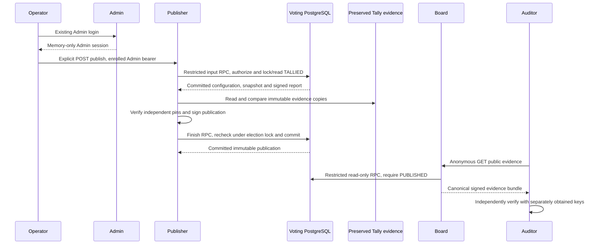

# Commit 10 — Publication, Public Board and independent verification

Branch `feat/public-results-bulletin-board`, base `main` at `45d101f`.
Implemented for human review. **The new PostgreSQL migration and disposable
publication CI gate have not executed.** Prior combined Admin/Voter/Tally CI
evidence does not establish a PASS for this extension.

## Architecture and authorization



The separate Publisher accepts an existing active `ELECTION_ADMIN` session only
when that principal is also explicitly active in `voting_board.publishers`.
Enrollment defaults inactive and is a trusted deployment operation; neither Admin
nor Publisher runtime can self-enroll. A normal unenrolled Admin gets 403. Voter,
Tally, invalid and expired/revoked Admin sessions cannot publish. Only the explicit
publication endpoint initiates the terminal transition; there is no arbitrary
signing endpoint.

Publisher receives a **different encrypted Ed25519 publication private key** and
read-only access to the preserved Tally evidence directory. It receives no RA
credential key, Tally RSA decryption key or snapshot/report signing private key.
Board receives only its own restricted database credential and three independent
public pins. It receives no private key, Admin session or RA database connection.
The default application and existing launchers remain unchanged and fail closed.

There are three independently configured raw Ed25519 public keys plus two key IDs:
manifest authority, Tally evidence authority/key ID, and publication authority/key
ID. The keys must be distinct. No endpoint supplies a key that can establish its
own trust. These pins must come from a trusted channel outside the Board response.
The browser build and offline verifier use their own explicit trust configuration.

Publication uses a separately authorized HTTP action and the interactive operator
client; the old Admin publication tab remains unwired. Admin, Voter and Tally UI
workflows are retained. The existing private Tally API remains scoped to its
CLOSED/TALLIED workflow; published evidence is read through the Board.

## Frozen contracts versus early drafts

Existing implemented contracts are authoritative and unchanged:

| Topic | Early draft | Frozen implementation retained here |
|---|---|---|
| Configuration | Document 06 describes `EVOTE-CONFIG-v1` and snapshot key fields | Actual signed election manifest uses `EVOTE-MANIFEST-v1\0`, `domain`, `version`, complete RA/Tally public-key metadata, roster/window and profile. It contains no snapshot/publication key ID. |
| Blind credential | Document 08 shows a smaller v1 message and flat submission | Frozen v2 has domain, version=2, election_id, serial, envelope_hash, config_hash and key_id; submission contains credential.message/prepared_msg/signature and envelope. |
| Tally report | Document 10 describes tally_id/tally_status in signed payload and a domain-prefixed digest | Actual `evote-tally-v1` report excludes those DB-only fields, includes aggregate invalid_reasons, and hashes **SHA256(JCS(report))** without a prefix. Its Ed25519 signature uses `EVOTE-TALLY-REPORT-v1\0`. No alternate digest is attempted. |
| Snapshot/receipt | Documents 08/09 | Existing `EVOTE-SNAPSHOT-v1\0` signature, JCS snapshot bytes, receipt-sorted records and `EVOTE-RECEIPT-v1\0` construction are reused exactly. |
| Publication key binding | Draft ties key IDs to fields absent from current configuration | Separate independently pinned evidence/publication key IDs, checked across the signed package. No frozen manifest/schema change. |
| Public visibility | Document 09 permits encrypted records during OPEN | This first public implementation releases **all Board evidence only after PUBLISHED**, reducing real-time correlation and avoiding partially authenticated feeds. |

AES-256-GCM, RSA-OAEP-SHA256, RSA-3072 RSABSSA/SHA384/PSS salt 48 and the 32-byte
Prepare prefix are unchanged. Public verification reuses the reviewed finalized
credential and receipt verification; it never performs blind signing or decryption.

## Publication transaction and recovery

1. `publication_input` checks the live Admin session, active publisher enrollment,
   database time and reconciled TALLIED/PUBLISHED control state. It locks the
   election row, requires the successful committed Tally job/report/final snapshot,
   validates their IDs/digests and checks the snapshot against committed ballots.
   The read transaction commits before any file/key work.
2. Publisher validates every signature, canonical object, digest, roster/count
   equation and frozen ballot proof under its external pins. It also requires
   exact original private snapshot/report evidence files. Missing files fail
   UNAVAILABLE; changed/conflicting bytes fail INVALID. They are never regenerated.
3. The publication authority signs the deterministic Document 10 manifest under
   `EVOTE-RESULTS-v1\0`. The signature is verified locally before persistence.
4. `finish` reauthorizes, locks the same election row and rechecks the exact
   immutable source data, report totals and package. It checks authorization again
   after waits/comparison. In one transaction it inserts the existing baseline
   publication row, its canonical self-contained bundle, transitions election and
   Admin control state to PUBLISHED, and appends `ELECTION_PUBLISHED` audit evidence.
   Success is returned only after commit.
5. Concurrent identical requests serialize on the election row and return the
   same bytes. The baseline UNIQUE(election_id) publication constraint remains.
   Conflicting packages fail 409; the existing publication is never overwritten.
6. Repeated publication reads/verifies the committed bundle and does not sign
   again. Lost-response recovery needs no new publication, original signing file
   or original private evidence file. Missing/corrupt committed public data fails
   closed rather than being substituted.

Lock order is authorization session/principal/enrollment shared locks, then the
election row; snapshot/report inputs are immutable reads. No new cross-database
transaction or RA write is introduced. Existing ballot acceptance/closing and
Tally fencing/locking rules remain unchanged.

No new publication filesystem artifact is staged. The verified public bundle is
stored atomically in PostgreSQL, avoiding a new database/filesystem commit split.
Original independent Tally files are required for first publication. A crash
before `finish` leaves TALLIED; a failed/rolled-back `finish` exposes nothing. A
committed publication is self-contained even if the original private evidence
directory later becomes unavailable. Its signatures and metadata are reverified
on reads. Offline signed bundles attest integrity/approval; they do not themselves
prove the current live database state or detect leaked pre-commit signatures from
a compromised Publisher.

## Forward migration and permissions

The optional [Board Alembic configuration](../alembic_board.ini) selects the existing
Voting/Admin/Tally chain plus new revision `f8b31c2d970a`, parent `e6a90c72b541`:

```text
643decaa90ab -> b5bd58a07ceb -> d8f27a4c610b
  -> af821c9e7601 -> e6a90c72b541 -> f8b31c2d970a
```

All six existing/new graph entries are selected for CI. No applied revision is changed.
Default baseline/Tally migration configurations remain unchanged.

Trusted provisioning must first create `voting_publication_login` and
`voting_board_login`: LOGIN, NOINHERIT, NOSUPERUSER, NOCREATEDB, NOCREATEROLE,
NOREPLICATION, NOBYPASSRLS, no memberships in either direction. Grant CONNECT only
to the intended Voting database. Password collection/provisioning must be private
and interactive or generated inside the owned test setup; no password literals or
password-bearing command arguments are provided by this change.

The migration verifies ownership, roles and effective ACLs before doing work. It
refuses unsafe schema CREATE, table/column DML, sequence or baseline/Admin/Tally
function privileges. CASE guards prevent privilege functions being evaluated on
incompatible relation kinds. It refuses any legacy publication/PUBLISHED rows
pending a separately reviewed evidence migration; it does not rewrite old data.

New structures are `voting_board.publishers` and `voting_board.evidence`. The
baseline `voting.publications` and its existing unique/FK constraints are reused.
The evidence table stores at most 16 MiB plus a database-checked SHA256 digest.
Admin control's CHECK adds PUBLISHED. Publication/evidence rows and publication
audit events get immutable row triggers; election/control state is terminal once
PUBLISHED. Existing snapshot/report/accepted-ballot immutability remains intact.

| Function | Return | Runtime EXECUTE |
|---|---|---|
| `publication_input(bytea,uuid)` | jsonb: original input and optional committed bundle hex | voting_publication_login |
| `finish(bytea,uuid,bytea,bytea,bytea)` | committed canonical bundle bytea | voting_publication_login |
| `read_public(uuid)` | canonical public bundle bytea, PUBLISHED only | voting_board_login |
| `catalogue(uuid,integer)` | ordered discovery JSON array, at most 51 entries | voting_board_login |
| `_actor`, `_input`, `immutable`, `terminal_state` | internal authorization/input/trigger helpers | owner only |

All eight functions are SECURITY DEFINER owned by `voting_owner`, with fixed
`pg_catalog,...,pg_temp` search paths and qualified SQL objects. PUBLIC EXECUTE is
revoked. Runtime receives schema USAGE and only its two specific RPCs, without
grant option. It gets no direct table/column/sequence DML and no owner/migrator
membership. Unexpected function/table/schema default grants abort the migration.
Existing RA, Voting, Tally and Admin grants are preserved. Board also uses a
read-only transaction as defense in depth. Owner/superuser bypass is outside this
runtime permission model; externally retained signatures are still essential.

## API inventory and exact public contracts

All local endpoints return `Cache-Control: no-store`, no-sniff and no-referrer
headers. Private errors have fixed text/codes and never echo parameters. Public
requests reject bearer/identity/cookie headers and GET bodies. There are no public
mutation routes. UUIDs are canonical lowercase, hashes lowercase hex64, binary
values canonical base64url without padding.

| Endpoint | Contract |
|---|---|
| `POST /api/v1/publication/elections/{id}/publish` | Authenticated Admin bearer plus DB enrollment; request exactly `{}` and <=128 bytes. 200 returns status=PUBLISHED, election_id, signed publication and bundle_digest; repeat returns identical metadata. 401/403 authorization, 409 state/conflict, 422 malformed, 503 integrity/unavailability. |
| `GET /api/v1/board` | Unverified discovery only: `{elections:[{election_id,status:"PUBLISHED"}],next_cursor}`; no unsigned title/totals. limit 1–50, default 25, UUID cursor. |
| `GET /api/v1/board/{id}/evidence` | Complete canonical public verification bundle, <=16 MiB. |
| `GET /api/v1/board/{id}/configuration` | Existing `{manifest,signature}` frozen configuration bundle. |
| `GET /api/v1/board/{id}/ballots` | `{election_id,records,next_cursor}`, receipt-sorted. limit 1–100, default 25. Cursor `1.election_id.snapshot_digest.last_receipt` binds the page to this immutable snapshot and an existing record. |
| `GET /api/v1/board/{id}/receipts/{hex64}` | 200 `{status:"FOUND",election_id,record}` or 404 NOT_FOUND. This alone is not a client verification result. |
| `GET /api/v1/board/{id}/snapshots/final` | Existing exact snapshot object. |
| `GET /api/v1/board/{id}/snapshots/final/manifest` | `{manifest,signature}` for the finalized snapshot. |
| `GET /api/v1/board/{id}/results` | `{status:"PUBLISHED",election_id,tally,publication}`; independent verification needs the complete evidence bundle. |

Unknown/unpublished elections return 404; a PUBLISHED election with broken/missing
authoritative public evidence fails 503. Duplicate/unknown query fields, malformed
limits, receipts and cursors are rejected. Pagination is deterministic keyset
pagination over immutable data, without offsets or acceptance timestamps.

The complete bundle has exactly:

```text
version: 1
election_id: canonical UUID
configuration: {manifest, signature}                  # unchanged
snapshot: {schema_version, election_id, election_config_digest, ballots}
snapshot_evidence: {manifest, signature}              # unchanged unsigned schema
tally: {report, report_digest, signature, signing_key_id}
publication: {manifest, signature}
```

Each ballot has exactly election_id, serial, encrypted envelope, prepared_msg,
signature and receipt_hash. No identity, issuance request ID, precise acceptance
timestamp, session or individual decryption/classification is served.

Publication manifest fields are exactly manifest_version=1, election_id,
election_config_digest, snapshot_digest, tally_report_digest, accepted_total,
valid_total, invalid_total, counted_total, publication_key_id and
signature_algorithm="Ed25519". Its signature is outside that object, over
`EVOTE-RESULTS-v1\0 || JCS(manifest)`. Package versioning introduces no change to
the signed snapshot, Tally report, receipt or frozen credential wire formats.

## Independent verifier and Public UI

The [offline Python verifier](../scripts/verify_publication.py) performs no network
or database access and loads only explicit public evidence and trust files. The
browser [verifier](../frontend/src/board/verification.ts) implements independent
WebCrypto checks with the reviewed client credential/receipt primitives. Tests
cross-check a generated browser RSABSSA evidence bundle against Python.

Both verify the configuration signature/profile/key binding, canonical snapshot,
snapshot SHA256/signature, all finalized credentials/envelopes/receipts, unique
serials and ordered receipts, signed Tally report/digest, election/configuration/
snapshot consistency, complete candidate roster, accepted=valid+invalid,
counted=valid=sum(candidate totals), sum(invalid reasons)=invalid, and publication
signature/totals/digests. Missing pins fail UNVERIFIED; supplied wrong signatures
or inconsistent even authentically signed counts fail INVALID.

Statuses are VERIFIED, NOT_FOUND, INVALID, UNVERIFIED and UNAVAILABLE. NOT_FOUND
is reported locally only after checking the complete signed snapshot. A network
404/unpublished election is UNAVAILABLE, not proof that a receipt is absent.
CLI exit codes: 0 verified, 3 not found, 1 invalid, 2 unverified/unavailable.

With explicit Board activation the existing `/public`, `/public/results/:id`,
`/public/board` and `/public/verify` routes use real Board APIs. They show verified
aggregate counts, percentages over valid ballots, invalid totals, signature/hash
metadata and a public evidence download. No count is rendered before local full
verification. Discovery labels use election UUIDs because the frozen manifest
does not sign an election title. Stale navigation results cannot replace the
current election's evidence. Missing/unpublished/error states remain explicit.

The receipt form sends no receipt in URLs or browser storage: it downloads the
complete signed public bundle with `credentials: omit` and checks inclusion
locally. All public fetches are separate from authenticated clients, omit cookies
and Authorization, disallow redirects, have a timeout and bounded streaming body,
and reject noncanonical/duplicate JSON. Evidence export uses the already verified
local bundle, not a cookie-bearing navigation to an API download. The default
frontend remains an honest unavailable foundation unless explicitly enabled.

## Local startup after human-approved deployment

Do not run migrations against a user database during review. A trusted operator
must review/provision the two roles, apply the new optional migration, and enroll
the approved existing Admin principal. There is no runtime enrollment endpoint.
Generate a separate encrypted Ed25519 publication key through trusted provisioning;
keep it outside Git and all static web directories. Do not reuse any existing key.

Prepare an independently distributed **public-only** trust file outside the repo:

```json
{
  "authority": "<base64url raw32 manifest authority pin>",
  "evidence": "<base64url raw32 Tally evidence pin>",
  "evidence_key_id": "<existing Tally snapshot/report key id>",
  "publication": "<base64url raw32 new publication public pin>",
  "publication_key_id": "local-publication-1"
}
```

The Tally evidence directory must be readable by Publisher through an explicit
read-only filesystem boundary; never grant it Tally private-key access. Keep the
existing Admin and Tally launchers running/configured as reviewed, then use
separate terminals (all passwords/passphrases are prompted privately):

```bash
python -m backend.board.launcher --enable-local-demo --role publisher \
  --trust-config /outside-repo/public-trust.json \
  --evidence-directory /outside-repo/tally-evidence \
  --encrypted-publication-key /outside-repo/publication.encrypted.pem
python -m backend.board.launcher --enable-local-demo --role board \
  --trust-config /outside-repo/public-trust.json
python scripts/publish_results.py --enable-local-demo --election-id <canonical-election-uuid>
```

Publisher binds 127.0.0.1:8007; Board binds 127.0.0.1:8006. Their fixed local DB
destination is voting_db:5432 with only the respective restricted login. There is
no credential discovery, key default, proxy trust, CORS grant or access logging.
The operator client authenticates against the existing Admin API, prompts for
explicit PUBLISH confirmation, invokes Publisher, then attempts Admin logout.
It never prints or persists tokens/passwords and reports unconfirmed revocation.
This supplies a real publication action while the old Admin publication tab stays
disabled. No Tally signing key is passed to Admin or to a browser.

For the frontend, use Node 24 and the existing locked install:

```bash
npm --prefix frontend ci --ignore-scripts
# Public values only; obtain these independently, not from a Board response.
export VITE_ENABLE_BOARD=true
export BOARD_DEMO_TARGET=http://127.0.0.1:8006
export VITE_MANIFEST_AUTHORITY_PIN=<trusted-authority-public-pin>
export VITE_EVIDENCE_PIN=<trusted-evidence-public-pin>
export VITE_EVIDENCE_KEY_ID=<trusted-evidence-key-id>
export VITE_PUBLICATION_PIN=<trusted-publication-public-pin>
export VITE_PUBLICATION_KEY_ID=local-publication-1
npm --prefix frontend run dev:local
```

Use equivalent shell environment syntax on Windows. These are public pins, never
private key/password environment variables. Existing RA/Voting/Admin/Tally enable
flags may be retained, with separate loopback service ports. Vite's Board proxy
rejects identity headers instead of silently stripping them. It does not proxy
publication actions; the interactive operator client talks to Publisher directly.

An auditor can save the canonical public bundle and verify without a voter login:

```bash
python scripts/verify_publication.py --bundle /outside-repo/published-election.json \
  --trusted-keys /outside-repo/independently-obtained-public-trust.json \
  --election-id <canonical-election-uuid> --receipt <public-receipt-hex64>
```

## Dedicated disposable CI and actual validation

[The new workflow](../.github/workflows/publication-board.yml) runs on pushes only
to this feature branch and input-free manual dispatch. It uses GitHub-hosted
Ubuntu 24.04, commit-pinned Actions, Node 24.22.3/Python 3.11.9, contents:read,
unchanged locked dependencies, no repository secrets, no artifact upload and no
continue-on-error. Existing workflows and real E2E suites are unchanged.

After full database-free/frontend/browser regressions it runs:

```bash
"$EVOTE_TEST_PYTHON" scripts/board_postgres_ci.py --allow-ephemeral-ci-database
```

The entrypoint refuses local execution, inherited PG/Docker targets and selectable
database parameters. It reuses the reviewed digest-pinned PostgreSQL 18 tmpfs
container helper, random loopback port, fresh `voting_demo_test_ci_*` name,
independent UUID comment marker and exact container/name/image/tmpfs/ownership/
role/version checks. It does not create or connect to RA. Restricted credentials
and cryptographic keys are generated in memory/private runner temp, never argv,
logs, repository files or artifacts.

This is a real **publication component gate**, not a replacement for the existing
Admin/RA/CIRCL/browser end-to-end gate. Trusted fixtures seed one synthetic OPEN
election; real Voting acceptance commits two valid encrypted ballots and one
authentic but AEAD-invalid ballot. The real restricted Tally service verifies,
decrypts and signs counts (3 accepted, 2 valid, 1 invalid, one vote per candidate).
Generated finalized PSS proofs in these fixtures exercise the unchanged verifier;
native blind signing remains covered by the unchanged earlier gates.

Required new PostgreSQL assertions are:

- 401 for Tally credentials, 403 for an unenrolled active Admin, and 409 before
  TALLIED; unpublished public reads return 404.
- Missing original evidence does not publish. Restoring that exact file permits
  safe retry without replacing snapshot/report bytes.
- A real uncommitted `finish` remains invisible to a separate public connection;
  rollback leaves TALLIED with no publication/audit row.
- Four concurrent HTTP publications all return the identical publication; one
  publication/audit row exists. Conflicting data is rejected; retry is idempotent.
- Every public API matches the signed bundle; valid/unknown receipts, deterministic
  pagination, original Voting receipt recovery and aggregate equality hold.
- Public artifacts contain no operator IDs, bearer tokens or generated database
  passwords. Tampered copies fail independent verification.
- Snapshot/report/publication/audit mutation and terminal-state rollback fail;
  runtime table access/role escalation are denied with SQLSTATE 42501. PUBLIC
  EXECUTE is absent and each role has only its intended RPCs.
- Services and private temp files shut down; the owned container is removed and
  its absence verified. Immutable rows are destroyed with that disposable cluster.

Expected final CI lines (not execution evidence):

```text
PASS: board_postgres_ci checkpoints=authorization,tally,rollback,concurrent_publish,public_verification,tampering,immutability,acl
PASS: board_postgres_ci owned_container=removed
```

Failures show only an allowlisted stage/category and well-formed SQLSTATE; no
exception messages, SQL parameters, credentials, payloads or tracebacks.

Executed locally on this exact checkout:

| Check | Actual result |
|---|---|
| Complete backend/crypto pytest | 921 passed: all previous 872 plus 49 new Board/publication tests |
| Frontend unit/component/crypto | 108 passed, 10 test files |
| Existing auth / voting / Admin / Tally browser suites | 7 / 7 / 2 / 2 passed |
| New Board mobile/desktop/tampering browser suite | 3 passed |
| TypeScript credential recovery | 2 passed |
| TypeScript checks, production build, crypto TypeScript build | PASS |
| Locked npm install/trees and Python dependency versions/integrity | PASS; no lock changes |
| Migration graph and offline SQL syntax | PASS; six revisions; SQL/PLpgSQL parsed without executing SQL |
| Python/JSON/YAML/Bash syntax, changed-source secret scan, diff whitespace | PASS |
| New PostgreSQL migration and publication gate | NOT RUN; pending human-approved Ubuntu Actions |
| Native Go locally | NOT RUN; unavailable on local PATH; no Go source/dependency changes |

Windows browsers used the existing Edge setting; CI installs Chromium. Python
used the project venv and supported PSYCOPG_IMPL=python/libpq18 import path because
Application Control blocks the bundled psycopg DLL. No security policy was changed
and no local PostgreSQL connection was opened. SQL parsing uses pglast 8.9 only
in an OS-temporary validation directory, not as a project dependency. It cannot
establish live column resolution, grants, row-lock behavior or migration success.
The existing Vite blindrsa `crypto` externalization notice remains; actual browser
crypto tests passed. One new tampering test initially omitted no-store headers;
its fixture was corrected to reach signature verification, keeping strict checks.

## Complete changed-file inventory

New backend/deployment/operator files:

- [Verification library](../backend/board/verification.py)
- [Publisher and Board services](../backend/board/service.py)
- [HTTP boundaries](../backend/board/http.py)
- [Explicit local launchers](../backend/board/launcher.py)
- [Forward migration](../migrations/board/versions/f8b31c2d970a_publication_board.py)
- [Optional migration configuration](../alembic_board.ini)
- [Interactive publication action](../scripts/publish_results.py)
- [Offline public verifier](../scripts/verify_publication.py)
- [Disposable PostgreSQL gate](../scripts/board_postgres_ci.py)
- [Dedicated workflow](../.github/workflows/publication-board.yml)

New frontend and test files:

- [Browser verifier](../frontend/src/board/verification.ts)
- [Anonymous bounded API client](../frontend/src/board/client.ts)
- [Public workspace](../frontend/src/board/workspace.tsx)
- [Generated test-only evidence](../frontend/src/board/fixtures.test-support.ts)
- [Cross-language and crypto tests](../frontend/src/board/verification.test.ts)
- [Component and client tests](../frontend/src/board/board.test.tsx)
- [Board browser configuration](../frontend/playwright.board.config.ts)
- [Synthetic browser fixture](../frontend/tests/board_fixture.py)
- [Responsive browser tests](../frontend/tests/board-browser/board.spec.ts)
- [Backend generated evidence fixtures](../tests/board_helpers.py)
- [Backend/public verifier tests](../tests/test_board.py)
- [Migration/CI safety tests](../tests/test_board_ci.py)
- [This report](./28-publication-bulletin-board.md)

Modified:

- [App routes](../frontend/src/app.tsx)
- [Explicit feature/public pin configuration](../frontend/src/config.ts)
- [Loopback Board proxy](../frontend/vite.config.ts)
- [Browser test script](../frontend/package.json)
- [Browser test type-check scope](../frontend/tsconfig.json)

Total: 28 files. Applied migrations, frozen crypto, existing backend services,
dependency locks, prior test assertions and workflows are unchanged. No commit,
push, merge, stash or worktree deletion was performed.

## Privacy/security limitations and review gate

Full verification requires public encrypted envelopes, serials and finalized
credential proofs to reproduce the existing receipt and complete snapshot digest.
This deliberately discloses linkable public receipt/record identifiers. Publication
is delayed until PUBLISHED, no acceptance timestamps or identity metadata are
released, and UI receipt search is local. Nevertheless external logs, user-shared
recovery proofs, traffic timing, small cohorts and retained ciphertext can correlate
people or choices. Future Tally key compromise can expose archived ciphertext;
this is not forward secrecy, full anonymity or coercion resistance.

VERIFIED proves signature/format/inclusion/count consistency under pinned trusted
authorities. It does not prove correct individual decryption/classification or
complete E2E tally correctness. A malicious authorized Tally authority can attest
dishonest counts; no zero-knowledge decryption proof or public plaintext is added.
An offline bundle does not prove current database availability/commit state, global
non-equivocation or the absence of a different bundle signed by compromised keys.
An independently retained copy and independently operated auditor remain valuable.

The initial local implementation uses one explicit trust set per deployment.
Historical key rotation needs externally retained old trust sets; keys are never
silently fetched/replaced. Loopback-only HTTP, same-OS-user demos and encrypted
files are not production isolation/HSM/TLS custody. Python/JS cannot promise secret
zeroization. Response/work limits are bounded (1000 ballots, 16 MiB bundle), but
there is no production streaming/CDN/abuse-control system; full verification per
request can be expensive. Successful publication has immutable audit evidence;
rejected attempts return sanitized errors rather than a new durable failure log.

The Admin publication tab is intentionally still disabled; use the authorized
interactive operator client and separate Publisher service. New PostgreSQL
execution, concurrency, ACL denials, rollback and owned-resource cleanup require
the dedicated Ubuntu run. Review these files and deployment assumptions before
approving migrations or branch publication. No live database or production private
key was accessed during implementation; generated test keys were used only in
isolated test fixtures. Stop for human review.
